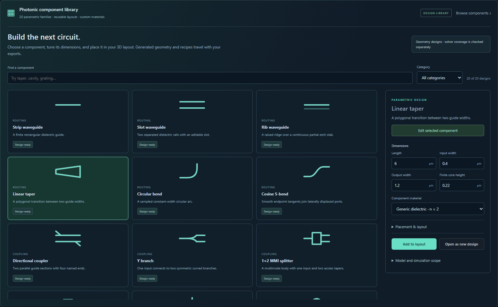
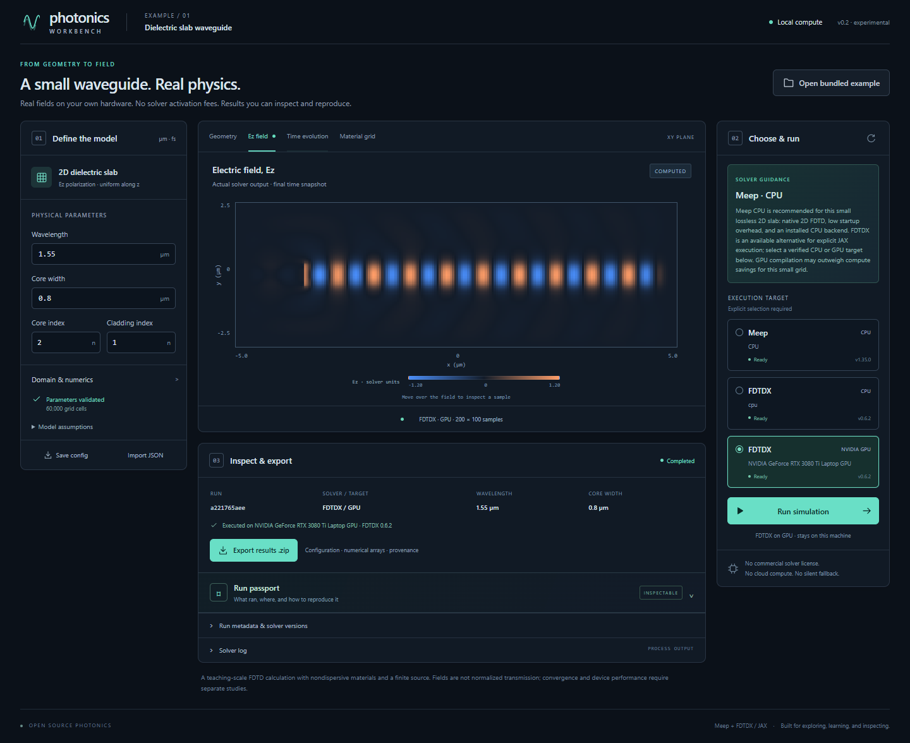

# Photonics Workbench

A local photonics workbench for students, researchers, and engineers: open a
dielectric waveguide, edit validated physical parameters, choose a real solver
and execution device, and inspect the electromagnetic fields it computes.

Built for the DevDay Exchange London Community Hackathon on 1 November 2026.
The application code was started during the event. Existing numerical libraries
provide the solvers; [build provenance](docs/PROVENANCE.md) and
[credits](CREDITS.md) distinguish that reuse from new work.

**Circuit Layout.** Save a planned link between two named ports, align the physical components, inspect their gap and facing error, or disconnect them. Connections travel with the design JSON, Python and Jupyter exports. The field solver uses the drawn solids. [Circuit editor walkthrough](docs/CIRCUIT_CONNECTIONS.md).

**Mesh refinement on NVIDIA.** The 100 nm ring-gap benchmark reports the actual mode splitting under four numerical treatments. The calibrated panel compares power and phase at matched planes, displays weak returns with their validity masks, and exports GPU time by stage alongside cells and steps. The full 3D studies have separate numerical and commercial agreement gates. [100 nm gap](docs/RING_GAP_MODES.md) · [Phase and weak reflections](docs/COMPLEX_PORT_COMPARISONS.md) · [GPU times](docs/GPU_TIMING.md).

**Calibrated components.** The workbench measures directional-coupler and splitter S matrices, multimode conversion, ring spectra and grating coupling in dedicated physical presets. Open **Calibrated components**, select an input, wavelength and local execution target, then inspect the measured data and export the run as Python and a Jupyter notebook. You can export the configured program before running it. In ring and grating plots, click the curve or choose a wavelength to read its measured power fraction. The v0.13.0a1 prerelease includes the measured ring and grating fields, three freshly executed grating notebooks, and a connected-strip design with its before-and-after GPU fields. The checklist identifies which devices, meshes and commercial observables have been verified. [Download the wheel and measured study programs](https://github.com/srinjoyganguly/photonics-workbench/releases/tag/v0.13.0a1) · [Calibration checklist](docs/CALIBRATED_COMPONENTS.md) · [Lumerical and Tidy3D comparisons](docs/CALIBRATED_VENDOR_CHECKS.md).

**Power comparison.** In a recorded ring or grating spectrum, choose a wavelength to inspect the local and published values. Lumerical ring records include through, drop, reflection and add-side modes. The power review separates resonance detuning, material sampling and receiver-mode effects. The two released full grating notebooks have now independently reproduced every optical field array on CUDA. [Accuracy review](docs/POWER_MISMATCH.md) · [Replayed full grating notebooks](docs/GRATING_NOTEBOOK_REPLAYS.md).

**Full spatial calibration.** Select **3D bus-loaded ring**, **3D finite-width grating**, or **3D layout ports**, choose NVIDIA, and run locally. Inspect normalized spectra, native field samples and published vendor curves at the same wavelength. Planar TM0/TM1 and custom polygon studies use Meep CPU. The observed discrepancies, including ring peak shifts and grating coupling differences, are recorded alongside the results. [Loaded rings](docs/LOADED_RING_3D.md) · [Finite-width gratings](docs/FINITE_GRATING_3D.md) · [Planar port controls](docs/PLANAR_PORT_CALIBRATION.md).

**v0.10 preview.** Select an object in 3D or XY to delete a component and
its ports in one edit, undo it or redo it. You can also join two components
using their named ports. [Editing and recovery](docs/EDITOR_RECOVERY.md).

Compare two meshes of a finite taper in the **3D ports & S-matrix** panel or
with the installed CLI. The passive Fabry–Pérot benchmark measures four modes
against the COMSOL example using local Meep. A selected material now has a
planar thin-film spectrum with complex amplitudes, power fractions and runnable
exports. [Material study](docs/PLANAR_FILM.md). [Taper mesh sensitivity](docs/TAPER_MESH_SENSITIVITY.md) ·
[Measured cavity modes](docs/PASSIVE_CAVITY.md) · [Remaining product work](docs/NEXT_CHUNKS.md).

Open **3D design** to draw a physical polygon or route in the
XY sketch, drag components into place, or browse **27 parametric component
families**. The seven additions cover Euler bends, strip-to-slot transitions,
1×4 MMIs, fan gratings, tapered couplers, photonic-crystal line defects and
pulley rings. [Component catalog](docs/COMPONENT_LIBRARY.md) · [XY sketch and field guide](docs/LAYOUT_FIELDS.md).

A finite-layout study runs eligible passive scenes on Meep CPU or FDTDX
CPU/NVIDIA. You choose an Ey dipole position and inspect the calculated
electric-field and dielectric grids. Every catalog family has a recorded
finite-field Meep run. The taper also supports a matched-lead field
study and separate guided modal measurements. [Taper fields](docs/TAPER_FIELDS.md)
· [Taper ports](docs/TAPER_PORTS.md).

The public evidence panel compares local calculations with ten published
observables from Lumerical MODE and Tidy3D examples. It includes mesh and
domain sensitivities and the differences that persist. [Reference checks](docs/COMPONENT_REFERENCE_CHECKS.md)
· [Commercial example coverage](docs/VENDOR_COMPONENT_COVERAGE.md).

The local wheel bundles the web interface and Python service. On Linux/WSL2
with Python 3.11, install the wheel with pip, use `photonics-workbench setup meep`
to provision Meep/MPB through Conda, and launch `photonics-workbench web`.
Use `setup fdtdx-cpu`, `setup fdtdx-cuda12` or `setup beamz-cpu` to provision a separate local worker. `photonics-workbench desktop` opens the dedicated application window.
[Download a prebuilt release](https://github.com/srinjoyganguly/photonics-workbench/releases) · [Installation](docs/PACKAGING.md) · [Desktop window](docs/DESKTOP_WINDOW.md) · [BeamZ reference studies](docs/BEAMZ_REFERENCE.md).

Choose **Open runnable 3D waveguide** to run a finite-height core with an optional
substrate through Meep CPU or FDTDX CPU/NVIDIA GPU. Inspect actual Ex/Ey/Ez and
material slices in XY/XZ/YZ, then export the exact study and numerical volume.
Select a field or port study to validate the geometry, material and grid for that model. **2D simulation** retains the
earlier slab workflow. [3D simulation guide](docs/3D_SIMULATION.md).
[Numerical validation and comparison limits](docs/VALIDATION.md).
[3D workspace guide](docs/3D_WORKSPACE.md) · [Product roadmap](docs/ROADMAP.md) ·
[Packaging and desktop design](docs/PACKAGING.md).

**Ports · 2D** adds a guided-mode pulse, a straight-guide reference, and measured
reflection/transmission spectra for a straight guide or a small cladding gap.
Choose Meep CPU or FDTDX CPU/NVIDIA GPU, inspect the measured settling criteria,
and export the raw monitor data, exact CSV and run passport.
These are finite-aperture power ratios, not complex modal S-parameters or 3D
port measurements. [Port measurement guide and evidence](docs/PORT_MEASUREMENTS.md).

**3D ports & S-matrix** now measures complex S11/S21/S12/S22 for a finite-height
straight guide or cladding gap, using forward/reverse reference and device
solves. Inspect real/imaginary amplitudes, power, phase and actual 3D fields.
[3D modal guide and numerical limits](docs/3D_PORTS.md).

**Python + Jupyter exports** preserve editable settings and the exact numerical
source used by the GUI. Saved-run bundles include reference arrays and a replay
comparison; no running API is needed. All implemented study formats are covered.
Design exports also preserve polygon contours/holes, material tables, recipe
parameters and geometric ports. Bundled generators and the geometry validator
permit standalone parametric edits without the repository or a running API;
unsupported electromagnetic geometries remain drafts.
[Standalone setup and reproduction evidence](docs/REPRODUCIBLE_EXPORTS.md).

The submitted v0.2 releases and recordings below preserve the event build.
The 3D editor, public benchmarks and port measurements were added after
submission and are not part of that entry.



**[Watch the submission demo](https://srinjoyganguly.github.io/photonics-workbench/submission-demo.mp4)** — the working application with no slides: real local NVIDIA simulation, field playback, run passport and export. The solver wait is shown in real time. [Video page and supplementary materials](https://srinjoyganguly.github.io/photonics-workbench/) · [Concrete Codex contribution](CODEX_USAGE.md). Simulations run locally after installation.

The [24-second Blender journey](https://srinjoyganguly.github.io/photonics-workbench/#blender-journey)
explains the same six steps with an original 3D schematic and actual recorded
2D fields. [Source assets and reproduction notes](docs/BLENDER.md) distinguish
the presentation from the numerical simulation.



[Public source repository](https://github.com/srinjoyganguly/photonics-workbench)

## Why this exists

A student should be able to move from a waveguide sketch to an inspectable
electromagnetic result on their own laptop, then hand a collaborator the exact
configuration and numerical data. This workbench makes that small journey
explicit: physical validation, an explained solver choice, an actual device
record, and a portable result that remains useful outside the interface.

The contribution is a local design, learning and reproducibility workflow around
two open solvers. It requires no paid solver activation or cloud account.
Commercial packages offer much broader modeling and validation; each workbench
study has an explicit supported scope. [Product rationale and judging evidence](docs/PROJECT.md)
describe the distinction and its limits.

## The complete journey

1. Choose **2D simulation** and open the bundled slab-waveguide example.
2. Edit wavelength, core width, and refractive indices. Numerical settings expose
   domain size, grid resolution, simulation duration, and PML thickness.
3. Read the capability-based solver recommendation and validation messages.
4. Explicitly select **Meep CPU**, **FDTDX CPU**, or a verified **FDTDX NVIDIA GPU**.
   Unavailable targets remain unavailable; no GPU-to-CPU fallback exists.
5. Run the simulation in an isolated local worker. Inspect status and logs, or
   cancel it.
6. View the actual final Ez field and discretized permittivity, or replay stored
   field frames at their recorded simulated times with one fixed amplitude scale.
   Inspect the run passport and export the results ZIP.

Configuration JSON can be saved and imported. A completed run retains its own
configuration, so later edits do not relabel an earlier result. The result ZIP
contains the configuration, numerical NumPy arrays, run metadata, sanitized
worker log, an offline HTML run passport, and a SHA256 file manifest. The passport
records actual execution, source assumptions, observed array checks, and a
reproduction command. Checksums identify files; they do not certify scientific
accuracy. Computation stays on the local machine; no OpenAI API key, runtime
chatbot, cloud solver, or paid commercial solver license is required.

## Run locally

The [v0.2.0 release bundle](https://github.com/srinjoyganguly/photonics-workbench/releases/tag/v0.2.0)
includes source and the built interface. After extracting it, install the API
and solver environments in the setup guide, then run `bash scripts/start.sh`;
you can skip the Node build step. Solver binaries and environments are not bundled.
That release contains the submitted 2D workflow. The post-event calibrated workbench is available as a pip-installable wheel with the compiled interface on [GitHub Releases](https://github.com/srinjoyganguly/photonics-workbench/releases). Building the wheel from source requires the frontend build.

Use Linux or WSL2, Python 3.11, Conda for Meep, and Node 22.12+ for building the
interface. Follow [the full setup instructions](docs/SETUP.md) to install the
separate API and solver environments, then:

```bash
cd frontend
corepack pnpm install --frozen-lockfile --fetch-timeout=600000
corepack pnpm build
cd ..
bash scripts/start.sh
```

Open [http://127.0.0.1:8000](http://127.0.0.1:8000). The start script binds only
to the loopback interface. Node is needed to build the interface, not to serve
the completed local application.

Reproduce a saved configuration without the browser:

```bash
.venv/bin/python scripts/run_simulation.py examples/slab-waveguide.json --output runs/reproduction-001
```

The output directory must be new. The solver and device recorded in the JSON
are used explicitly. Set `MEEP_PYTHON` or `FDTDX_PYTHON` when the corresponding
solver lives outside the default project-local environment.

## Verification status

The v0.7 library's 20 generators pass dimension/topology checks, transformed
port-aperture checks and JSON round trips. [Browser checks](docs/verification/component-library-browser.json) cover component
selection, placement, regeneration, custom shapes/materials and design exports.
Standalone Python and executed notebooks reproduce all 20 default families
plus a custom-material design: **42 design replays**
([execution record](docs/verification/component-library-exports.json)).
The actual GUI-downloaded bundle also passes both Python and notebook replay
([download/replay record](docs/verification/component-library-gui-export.json)). These checks establish
geometry preservation and local editing, not electromagnetic performance for
the new components. [Library scope and checks](docs/COMPONENT_LIBRARY.md) ·
[Export contracts](docs/REPRODUCIBLE_EXPORTS.md). The v0.7 application suite has
132 passing tests and four native-Meep checks skipped in the API interpreter;
all 18 geometry-model tests pass. Real numerical checks remain separate from
those application/design tests.

The existing finite-height guide also completed fresh real browser runs on
[Meep CPU](docs/verification/v07-3d-browser-meep-cpu.json),
[FDTDX CPU](docs/verification/v07-3d-browser-fdtdx-cpu.json) and
[FDTDX NVIDIA GPU](docs/verification/v07-3d-browser-fdtdx-gpu.json).
Those checks compare rendered field samples with saved solver arrays and
exercise actual result exports. [v0.7 verification summary](docs/verification/v07-checks.json).

The v0.6 [3D modal study](docs/3D_PORTS.md) has four-direction real simulations
on Meep CPU and FDTDX CPU/NVIDIA GPU, with straight/gap, settling and numerical
sensitivity checks. [Meep evidence](docs/verification/meep-ports3d.json) and
[FDTDX evidence](docs/verification/fdtdx-ports3d.json) retain raw-array hashes,
complex matrices, measured discrepancies and implementation corrections.
The default mesh remains exploratory: Meep 16→20 cells/µm changes modal power
by up to 0.02066. [Standalone export evidence](docs/verification/reproducible-exports.json)
compares actual Python/notebook reruns with their saved GUI results; this is
implementation repeatability, not a commercial-accuracy certificate.
The complete modal browser journey is recorded for
[Meep CPU](docs/verification/ports3d-browser-meep-cpu.json),
[FDTDX CPU](docs/verification/ports3d-browser-fdtdx-cpu.json) and
[FDTDX NVIDIA](docs/verification/ports3d-browser-fdtdx-gpu.json).
[Editor export checks](docs/verification/code-export-browser.json) cover general
geometry and all four study formats without launching a solver.
The v0.6 application suite passed 112 tests with four Meep runtime checks
skipped in the API environment; real solver evidence is recorded separately.
That milestone's 12 geometry-model tests, TypeScript and production build passed.
The [v0.6 verification summary](docs/verification/v06-checks.json) indexes the
tested routes and limits, including 24 real Python/notebook solver replays.
The existing [2D field/playback](docs/verification/v06-2d-regression.json) and
[2D port](docs/verification/v06-ports-regression.json) browser regressions pass.

The finite-height 3D milestone has separate [Meep numerical evidence](docs/verification/meep-3d.json)
and [FDTDX CPU/GPU evidence](docs/verification/fdtdx-3d.json): correct material
placement, finite nonzero Ex/Ey/Ez, downstream propagation, height sensitivity,
actual GPU placement and explicit unavailable-GPU failure. Meep resolution/PML
sensitivity is recorded; it is not a convergence certificate. The
[3D simulation guide](docs/3D_SIMULATION.md) describes sampling, supported
geometry and limitations. New application tests also verify schema rejection,
plane/component indexing, immutable exports and corrupt-volume errors.
**Same-study comparison** checks compatible saved runs from one solver, including
FDTDX CPU/GPU pairs, without resampling or amplitude fitting. Its discrepancy
metrics have no accuracy pass threshold. [Validation status](docs/VALIDATION.md)
documents the default grid's measured sensitivity and the unfinished analytical
and commercial benchmarks for driven 3D fields; general commercial agreement is
not claimed.

Public-reference **mode benchmarks** are now available in the interface, with
local MPB calculations, source links, mesh/domain sensitivity and JSON export.
They reproduce the COMSOL slab model and compare published Tidy3D and Lumerical
effective-index scalars. Conflicting material indices in Lumerical's article and
script remain separate cases. See [results and reproduction](docs/PUBLIC_BENCHMARKS.md)
and the [convergence plot](docs/verification/public-mode-convergence.png).
These checks establish evidence for the named mode problems; they do not
qualify the driven 3D FDTD fields or establish general commercial parity.
The separate [product-adapter propagation check](docs/verification/public-slab-propagation.json)
records six actual Meep CPU/FDTDX GPU slab runs, including unfavorable centerline
measurements and the explicitly defined transverse-mode projection. The expanded
v0.4 benchmark suite had 61 passing tests and two Meep numerical cases skipped in the
API environment; real Meep runs are independently recorded. The [benchmark UI test](docs/verification/public-benchmarks-browser.json)
checks exact numbers, JSON export, mobile layout and missing/error states.

The complete 3D browser journey passed on [Meep CPU](docs/verification/3d-browser-meep-cpu.json),
[FDTDX CPU](docs/verification/3d-browser-fdtdx-cpu.json), and
[FDTDX NVIDIA GPU](docs/verification/3d-browser-fdtdx-gpu.json).
[Numerical export checks](docs/verification/3d-http-exports.json) verified 81 API
slices against the exported arrays. [Viewer/comparison checks](docs/verification/3d-slices-comparison-browser.json)
cover delayed responses and CPU/GPU metrics; [worker checks](docs/verification/3d-final-worker.json)
cover real cancellation and GPU repeatability. That milestone's API environment passed
48 tests with two Meep numerical tests skipped there; real Meep execution is
separately verified in its solver environment. The [original 2D browser journey](docs/verification/2d-browser-after-3d.json)
also passes after this increment.

The post-event [3D editor checks](docs/verification/3d-editor.json) cover actual
WebGL orbit/pan/zoom, picking, edits, undo/redo, import/export, draft recovery,
cross-tab conflicts, responsive layouts, and context-loss/unavailable-WebGL
behavior. All 12 geometry-model tests passed. [Fresh browser regressions](docs/verification/3d-solver-regression.json)
also passed real Meep CPU and FDTDX NVIDIA GPU runs, numerical ZIP checks,
and exact recorded-frame playback. Those earlier v0.3 checks verify a geometry editor alongside
the existing 2D solver workflow; they do not establish a 3D solver adapter.

The table below also retains evidence from the submitted v0.2 baseline.

| Route or check | Evidence and status |
| --- | --- |
| FDTDX 0.6.2 / JAX 0.10.2 on CPU | Real default and edited-width waveguides passed; finite nonzero fields and correct material arrays |
| FDTDX 0.6.2 / JAX 0.10.2 on NVIDIA | Real default waveguide passed on RTX 3080 Ti Laptop GPU, 16 GB; actual CUDA placement checked |
| GPU unavailable/fallback guard | GPU-blocked execution failed explicitly; no CPU retry |
| Meep 1.35.0 on CPU | Real shared-worker default and edited-width waveguides passed; finite nonzero propagated fields, material/coordinate checks, and explicit GPU rejection |
| Frontend build | TypeScript check and Vite production build passed using Node 24.22.1 / pnpm 11.25.0 |
| HTTP journey and export | Meep CPU, FDTDX CPU, and FDTDX GPU passed; exported arrays exactly matched the field API; config and target metadata matched |
| Browser journey on all three routes | Real edited-width runs, invalid-input feedback, field/material views, ZIP export, explicit selection, JSON import, and immutable run snapshots checked |
| Failure and cancellation | Unit/API checks passed; a cancelled worker cannot return a completed field or result export |
| Recorded frames and run passports | All three routes checked through HTTP: first/middle/last frames and simulated times exactly matched the saved arrays; fixed global scale and exported SHA256 manifests matched |
| Responsive interface | Browser checks passed at 1440, 1280, and 390 px with no overflow or browser errors |
| Meep fresh-environment setup | Documented YAML created a fresh prefix from cached official packages; real worker output matched the first environment exactly |
| API clean install | Fresh isolated virtual environments installed from SHA256-verified official PyPI wheels; dependency check passed; v0.2 regression suite: 23 passed, with the separately tested Meep numerical case skipped |
| FDTDX clean install | Not yet established; numerical verification used an existing environment with recorded versions |

[FDTDX verification](docs/FDTDX_VERIFICATION.md) records the exact measured
times, devices, and numerical checks. The first default Meep run took about
1.8 seconds inside the adapter; the first default FDTDX runs took about
16.4 seconds on CPU and 17.9 seconds on GPU including imports, setup, main-loop
compilation, execution, and export. These are single-run observations on one
machine, not a GPU speedup claim. Small jobs can spend more time compiling than
solving. The [Meep adapter notes](docs/meep.md) and
[recorded metadata](docs/verification/meep-cpu.json) describe its model and tests.

Run the focused application tests and dedicated numerical checks as described
in [setup and testing](docs/SETUP.md). A skipped solver test is not evidence that
the route works.

[HTTP, browser, cancellation, and demo evidence](docs/verification/) records the
checks. [Optional browser-test instructions](docs/browser-tests.md) describe the
separate Playwright setup used for UI verification.

The repository and both videos were checked in fresh signed-out browser contexts.
Public playback worked without authentication; playback and late seeking were
verified for the 86.16-second working demo. The Blender film is 24 seconds. [Link-check evidence](docs/verification/public-links-v0.2.json)
records the observations.

## Scientific scope and limitations

The earlier 2D example is a lossless, nondispersive dielectric slab with Ez
polarization, a finite-width source, and absorbing x/y boundaries. FDTDX uses a
three-cell periodic z extrusion; Meep uses native 2D. Both sources ramp over four
optical periods. Meep injects an electric-current line while FDTDX injects a
directed E/H plane, so absolute amplitudes are not cross-solver calibrated.

The original 2D field viewer shows a finite-time field snapshot and recorded time frames in arbitrary
source units, including the PML region. Playback uses only saved numerical samples;
the final snapshot can be later than the last recorded playback frame. It does
**not** report normalized transmission,
S-parameters, mode purity, convergence, or experimentally validated device
performance. Material interfaces and sampled coordinate grids differ between
solvers. A minimum grid rule prevents obviously coarse inputs but does not
replace a convergence study.

The separate **Ports · 2D** study measures incident-normalized total power using
a reference solve and coherent reflected-field subtraction. It masks bins when
either solve has not met its energy/spectrum settling criteria or incident power
is too weak. The residual `1-R-T` includes radiation outside the monitor aperture
and numerical error; it is not absorption. Meep and FDTDX use distinct mode and
grid implementations. Device agreement, settling and the reported refinement
checks do not establish general commercial-solver accuracy.

The application permits one job at a time. Older field and 2D port studies have
a five-minute limit; four-stage 3D modal studies have a twenty-minute limit.
The 2D study caps its x-y grid at 180,000 cells; the 3D study has separate
[volume and work limits](docs/3D_SIMULATION.md#supported-physical-model).
NVIDIA support depends on a compatible
Windows/Linux host driver and a working JAX CUDA environment; GPU visibility
alone does not establish working execution. Native Windows solver execution,
other GPUs, remote compute, multi-GPU jobs, and MPI are not supported by this
milestone.

The 3D workspace requires WebGL 2 for interactive geometry. Library component
ports are connection metadata, not solved modes. Constant and tabulated n/k
records preserve design data; dispersion fitting, anisotropy and active
materials are not qualified simulation features. Passive DBR and nanobeam
cavity layouts contain no pumping, gain, carrier dynamics or laser prediction.
The [laser roadmap](docs/COMPONENT_ROADMAP.md) separates cold-cavity validation,
gain benchmarks and semiconductor/electrical/thermal modeling.

The original rectangular 3D field study accepts one centred, unrotated guide spanning the
domain along x, plus an optional substrate flush with the core bottom. The separate finite-layout study accepts bounded passive solids, bends, rings and couplers. In the original 3D
field study, the source is a fixed
finite Ey excitation with a four-period startup; no eigenmode normalization,
S-parameters, flux analysis, or 3D time animation is provided. Material indices
are real, scalar and nondispersive. FDTDX's displayed components are spatially
averaged to common cell centres, with raw Yee fields retained in exports; Meep
samples its fields through its documented array API. Read each run's sampling
metadata and numerical limitations before comparing results.
The separate 3D modal study adds a centred gap, guided-mode excitation and a
two-port complex S-matrix. It has its own phase/gauge, material-sampling and
settling contract; it does not generalize the solver to arbitrary CAD.
MPB already supplies the separate public mode benchmarks and Meep port-source
profiles; a general mode/band-study interface remains future work. BeamZ,
generalized CAD/GDS editing, optimization, multiphysics, installable desktop
packaging and broad commercial-tool feature parity are also future work.

## Contribution and licensing

[CODEX_USAGE.md](CODEX_USAGE.md) records a concrete implementation/debugging
contribution and its verification evidence. The human supplied the problem,
users, solver choices, local-compute requirement, and delivery constraints.
Codex implemented and tested the application under those directions.

New application source is [MIT licensed](LICENSE). Meep is GPL-2.0-or-later;
FDTDX is MIT licensed; JAX is Apache-2.0 licensed; optional NVIDIA runtime
components have their own licenses. See [credits and dependency notices](CREDITS.md).
The repository does not redistribute solver environments, private handoffs,
reference screenshots, credentials, or raw chats.
