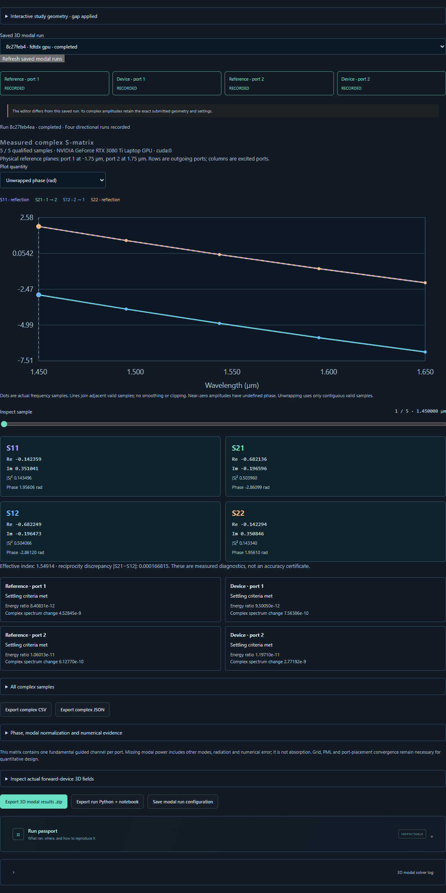

# Finite-height modal ports and complex S-parameters

The v0.6 preview adds a distinct executable study, `schema_version: 4` and
`study_type: "waveguide-ports-3d"`. It measures one Ey-like fundamental guided
channel at each end of a finite-height rectangular guide. A straight guide and
a centred cladding-filled gap are supported, with an optional continuous
substrate. Arbitrary rings, bends and couplers remain geometry drafts.

## Use the workbench

1. Open **3D design**, then **3D ports & S-matrix**, or select **3D modal
   S-parameters** below the geometry editor.
2. Open the straight validation or gap example. Edit core width, finite height
   and index in the Inspector; edit the gap, band and numerical settings in the
   modal study. The optional study preview applies the gap to the 3D geometry.
3. Review validation, source/port assumptions and the four-solve resource
   estimate. Explicitly choose Meep CPU, FDTDX CPU or an available NVIDIA GPU.
4. Run the S-matrix. The four reference/device stages are reported separately;
   cancellation stops the entire isolated worker. The bounded modal job has a
   twenty-minute wall-clock limit. Older studies retain their five-minute limit.
5. Inspect real/imaginary amplitudes, magnitude, modal power and phase. The
   wavelength slider and table show the actual saved numerical samples.
6. Expand the actual forward-device 3D fields to inspect Ex/Ey/Ez and material
   slices in XY/XZ/YZ. The final volume is a late pulse-decay snapshot, not a
   steady-state field reconstructed from the S-matrix.
7. Export complex CSV/JSON, the numerical ZIP or **run Python + notebook**.
   The last export includes an independent executable source bundle and its
   saved numerical reference; see [reproducible exports](REPRODUCIBLE_EXPORTS.md).

Later editor changes do not relabel a saved result. A separate editor export
contains the currently validated study, while a run export contains that run's
immutable settings.

## Canonical model and sampling

| Parameter | Bundled gap study |
| --- | --- |
| Domain | 8 × 4 × 4 µm |
| Core | Full domain length × 0.75 µm width × 0.5 µm finite height |
| Core / background index | 2 / 1; lossless, isotropic and nondispersive |
| Gap | 0.25 µm along x, replacing core with cladding |
| Substrate | Absent by default; optional, touching the core bottom |
| Band | 1.45–1.65 µm, five uniformly spaced frequency samples |
| Grid | 16 cells/µm; 128 × 64 × 64 FDTDX cells |
| Boundaries | 0.75 µm PML on all six faces |
| Sources | x = −2.75 / +2.75 µm for forward / reverse incidence |
| Physical port planes | Port 1 at −1.75 µm, port 2 at +1.75 µm |
| Modal aperture | 2.5 × 2.5 µm in y/z |
| Temporal criteria | Energy decay 10⁻⁷, complex spectral change 10⁻⁴ |
| Maximum after-source time | 600 fs per stage |

The same centre-frequency mode profile excites a finite-band Gaussian pulse.
Monitor modes are resolved at each measured frequency. This source is strongly
mode-dominated in the qualified examples, but broadband launch purity is not
assumed to be mathematically exact. Source, aperture and grid sensitivities
remain part of a quantitative study.

The existing bounded geometry contract is reused: one centred, unrotated core
box spanning x, and optionally a substrate filling x/y up to its lower surface.
Hidden objects still participate. Solids are never silently discarded or
projected into a different geometry. FDTDX records actual rounded voxel bounds
and planes; they can differ from fractional-cell requests.

## What is measured

Each job performs four independent time-domain solves:

- Straight reference excited from port 1.
- Requested device excited from port 1.
- Straight reference excited from port 2.
- Requested device excited from port 2.

At each input, the reference's complex E/H monitor fields are subtracted before
the reflected mode is measured. Transmitted fields retain their actual device
amplitude and propagation phase. The matrix uses unit-power modal coefficients:

```text
b = S a
S11 = reflected at port 1 / reference incident at port 1
S21 = transmitted at port 2 / reference incident at port 1
S12 = transmitted at port 1 / reference incident at port 2
S22 = reflected at port 2 / reference incident at port 2
```

`s[frequency, outgoing_port, incoming_port]` is ordered as
`[[S11, S12], [S21, S22]]`. Power in a channel is `abs(Sij)**2`. The total
fundamental-channel power for an incident port is the sum down that column.
Its residual includes radiation, other modes, finite-aperture/source effects
and numerical error; it is not absorption in these lossless materials.

Phase is referenced to the **actual physical monitor planes**, with the time
convention and mode gauge recorded in metadata. The common convention is
`exp(-i ω t)` in time, `exp(+i β x)` for positive-x propagation, and a
positive-real dominant Ey anchor. No transmission-unity normalization, fitted
phase adjustment or automatic de-embedding is applied. The straight reference's
complex through ratio is saved rather than forced to one. Near-zero amplitude
(`abs(S) <= 1e-8`) has no displayed phase; its raw complex value is preserved.
Unwrapped phase joins only contiguous valid frequency samples.

## Solver implementations

Meep uses native 3D propagation and MPB-based modal decomposition. Positive and
negative propagation are projected using separate signed-k unit-power modes,
each with its own recorded Ey gauge. The native coefficients and both signed
mode records are retained. This distinction was necessary to obtain consistent
reflection normalization on the Yee overlap grid; using the backward branch
of one fixed positive-k solve failed the symmetric-gap check. Exact transverse
mirror symmetries reduce work without turning the model into a 2D extrusion.
[Meep modal decomposition](https://meep.readthedocs.io/en/latest/Mode_Decomposition/)
and [Python examples](https://meep.readthedocs.io/en/latest/Python_Tutorials/Mode_Decomposition/).

FDTDX 0.6.2 uses actual E/H phasor monitors with its exact spatial/time
interpolation. The adapter resolves local per-frequency modes and evaluates
reciprocal complex modal overlaps; it does not take square roots of scalar
power. The installed version's overlap API differs from newer online releases,
so the inspected implementation and pinned versions are part of the record.
Source modes are prepared locally on CPU, including a phase-gauge correction
before extracting real transverse injection profiles. Field evolution and
placement checks use the explicitly chosen CPU or NVIDIA GPU.
[FDTDX mode source](https://fdtdx.readthedocs.io/en/stable/api/fdtdx.ModePlaneSource.html)
and [phasor detector](https://fdtdx.readthedocs.io/en/stable/api/fdtdx.PhasorDetector.html).

For the gap's x-normal dielectric interfaces, the FDTDX adapter places the
tangential Ey/Ez permittivity at their Yee positions by averaging adjacent
x-cell values; Ex retains its cell-centred coefficient. Broadcasting one
cell-centred scalar unchanged to all three components displaced the tangential
interface and failed reflection symmetry. This bounded correction is applied
before evolution and exported as component permittivity grids. It is not a
general conformal or subpixel material implementation. The distinction between
parallel and perpendicular dielectric averaging is described in
[Meep's interface treatment](https://meep.readthedocs.io/en/latest/Subpixel_Smoothing/).
Neither correction patches the installed solver packages; both travel with
the exported first-party adapter code.

## Validity and numerical limits

Both reference directions must contain sufficient incident modal power, the
per-frequency modes must pass the recorded guidance checks, and every stage
must satisfy energy and **complex-spectrum** settling. Checking power alone
would miss a changing phase. Stopping definitions and measured histories are
exported for each solver. A time cap leaves the raw data available while
invalidating the matrix; completion is not a convergence certificate.

The API and plots mask invalid samples with `null`, never fabricated zeros.
NPZ/CSV preserve raw coefficients with validity flags. Values above unity,
negative real/imaginary components and measured discrepancies remain visible.
The reader audits `S = outgoing / incident`, dimensions, frequencies, modal
guidance, thresholds, reference planes and consistency with the saved study.
Exports reject contradictory configuration snapshots or altered CSV data.

The default grid is exploratory. Measured transmission phase differs from
continuous-mode `β × distance` because the time-domain grid has numerical
dispersion. Refinement and plane/domain checks quantify this sensitivity;
they do not establish a universal error bound or agreement with commercial
solvers. Source-mode bandwidth, finite aperture, PML and material sampling also
matter. CPU/GPU equality and exact code replay can reproduce the same numerical
error and are reported separately from accuracy. In the canonical Meep gap,
16→20 cells/µm changes modal power by up to 0.02066 and complex S by 0.04976;
the default is explicitly not a spatially converged result.

Actual qualification records are retained in
[Meep evidence](verification/meep-ports3d.json) and
[FDTDX evidence](verification/fdtdx-ports3d.json). Their failed prototype checks
are distinguished from the corrected implementation. Browser and standalone
replay evidence are linked from the export guide.

The real edited-gap GUI journey passed on [Meep CPU](verification/ports3d-browser-meep-cpu.json),
[FDTDX CPU](verification/ports3d-browser-fdtdx-cpu.json) and
[NVIDIA GPU](verification/ports3d-browser-fdtdx-gpu.json), including numerical
array-to-plot checks and code/results downloads. The
[source passport check](verification/ports3d-source-passport-browser.json)
verifies that the saved implementation hash is visible in the interface.



## Data and API

| File | Meaning |
| --- | --- |
| `config.json`, `metadata.json` | Exact study, runtime versions, actual device, modes, planes, phase and four settling records |
| `sparameters.npz` | Wavelength/frequency, complex S, incident/outgoing coefficients, reference through ratios, effective indices and validity masks |
| `sparameters.csv` | Real/imaginary, magnitude, power and phase columns with validity flags |
| Four `*-monitors.npz` files | Actual per-stage native modal/field evidence; array conventions are solver-specific |
| `port-modes.npz` when present | FDTDX native/interpolated mode fields, gauge, effective indices and coordinates |
| `arrays.npz` | Actual forward-device final Ex/Ey/Ez volume and coordinates; FDTDX also retains raw Yee fields and component permittivity |
| Passport / manifest | Reproduction instructions and SHA256 for original numerical files |
| `implementation.zip` for new runs | First-party numerical source captured before solver execution and verified unchanged on completion |

`sparameters.npz` is indexed by increasing wavelength. Supplemental native
monitor files document their own frequency/component ordering. The displayed
FDTDX volume uses common cell-centre field samples; raw staggered fields remain
available. When component permittivity is present, a material slice selects the
same component as the field selector.

Endpoints: `/api/ports3d/example`, `/capabilities`, `/validate`, `/jobs` under
the same prefix; completed jobs expose `/api/jobs/{id}/sparameters`,
`/sparameters.csv`, `/volume`, `/slice`, `/export` and `/reproduce`.

```bash
.venv/bin/python scripts/run_simulation.py examples/ports3d-gap.json --output runs/modal-reproduction-01
```

Use a new output directory. The bundled JSON explicitly selects Meep CPU;
choose `solver: "fdtdx"` and `device: "cpu"` or `"gpu"` explicitly for FDTDX.
