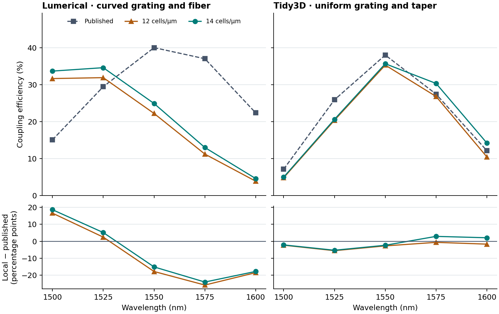

# Vendor comparison measurements

The calibration checklist distinguishes a matched observable from a method
comparison. A transmission coefficient is comparable only when both studies
use the same structure, materials, launch mode, reference planes, normalization
and collection aperture.

## Full 3D ring and grating comparisons

The workbench runs each reference geometry on local NVIDIA hardware. The four comparisons below use the originating vendor's own observable. For rings we compare both the spacing between successive drop resonances and the through/drop powers at the original wavelengths. A correct spacing can coexist with a large error at an individual wavelength when the resonances shift.

| Published design | Compared observable | Origin of the reference |
| --- | --- | --- |
| Lumerical two-bus silicon ring | Through and drop power spectra and central resonance spacing | Numerical sweep accompanying the [Ansys 3D parameter-extraction example](https://optics.ansys.com/hc/en-us/articles/360042800213-Ring-resonator-getting-started-Final-parameter-extraction) |
| Tidy3D two-bus silicon ring | Through and drop spectra and central resonance spacing | Digitized curves in the [Flexcompute add/drop notebook](https://www.flexcompute.com/tidy3d/examples/notebooks/RingResonator/) |
| Lumerical curved grating | Power transferred from the tilted polished fiber into the output guide, compared with the published S21 power | Numerical port data with the [Ansys grating example](https://optics.ansys.com/hc/en-us/articles/360042305334-Grating-coupler) |
| Tidy3D uniform grating | Coupling from a tilted Gaussian beam through the finite grating and taper into the output guide | Digitized coupling curve in the [Flexcompute 3D grating notebook](https://www.flexcompute.com/tidy3d/examples/notebooks/GratingCoupler/) |

Each grating comparison uses the same five wavelengths from 1500 to 1600 nm. Each mesh has its own simulated incident reference. In **Calibrated components**, select a measured record, then a wavelength to inspect the local value and its difference from the published curve. Compare the mesh records separately before using an absolute power or peak position in a design. [Measurement checklist](CALIBRATED_COMPONENTS.md) · [Ring modes, meshes and losses](LOADED_RING_3D.md) · [Grating geometry, source and field checks](FINITE_GRATING_3D.md).

The lines join the five measured wavelengths. The lower panels show local minus published coupling in percentage points on the same scale for both geometries. [Raw measurements and source checks](FINITE_GRATING_3D.md).

## Matched Lumerical and Tidy3D cross sections

The published Lumerical SOI evanescent coupler has two 0.5 µm wide,
0.2 µm high rails, a 50 nm gap, an index-1.5 substrate and air above.
At 1.55 µm its published even/odd indices are 2.378022 and 2.317864 and its
full-transfer length is 12.8827 µm. The installed Tidy3D CPU mode solver,
using the same rail geometry and material indices at 12.5 nm spacing, measured
2.389748 and 2.329884, giving 12.94620 µm. The length differs by 0.493%.
An independent prior MPB refinement reached 12.96196 µm.
[Lumerical example](https://optics.ansys.com/hc/en-us/articles/360042304694-Evanescent-waveguide-couplers) ·
[Tidy3D local mode-solver workflow](https://www.flexcompute.com/tidy3d/examples/notebooks/ModalSourcesMonitors/) ·
[Mesh series and measured data](verification/v011-vendor-port-modes.json) ·
[MPB refinement](COMPONENT_REFERENCE_CHECKS.md).

The same optional script checks the published 220 nm planar silicon TE mode,
the two guided modes of our offset slab and strip, and the even/odd modes of
our coupled section. The local Tidy3D calculations use uniform grids with
local subpixel handling disabled; the mesh dependence is recorded. It runs
locally with the Tidy3D Python package and accepts `--output NEW_JSON_FILE`.
[Published Lumerical slab-mode step](https://optics.ansys.com/hc/en-us/articles/1500007378182-Inverse-design-of-an-efficient-narrow-band-grating-coupler) ·
[Comparison program](../scripts/calibrated_port_references.py).

A coupling length inferred from two straight-guide supermodes differs in meaning
from a complete port matrix of a device with bends and access guides. The
device records retain their own uncertainties and comparison conditions.

At the finer **6.25 nm** spacing, local Tidy3D measured 2.382815 and 2.323811 for the Lumerical section, giving **13.13462 µm**. Its transfer length differs from the published Lumerical value by **1.956%**, larger than the 12.5 nm result. The 50 nm gap puts some interface locations on different Yee-grid sampling offsets as the mesh changes. The unsmoothed sequence gives an empirical sensitivity range; a single favorable mesh is insufficient to establish agreement at 0.5%. For the workbench 125 nm gap, local Tidy3D changed from 25.4064 to 23.5646 µm while the Meep/MPB straight-section estimate is 21.8532 µm. Reproduce the extended local mode series with `--refine-couplers`. [All mode samples](verification/v011-vendor-port-modes.json) · [Independent workbench cross sections](verification/v011-multiport-mpb.json).

## Matched spectra and mode conversion

- The loaded Lumerical add/drop reconstruction supplies four measured spectra at 561 wavelengths. Its planar free spectral range is 40.25 nm compared with the published 25.4549 nm. The comparison includes absolute wavelength and a finite-time linewidth qualification. [Measured ring spectrum](verification/v011-ring-loaded-lumerical-fine.json) · [Lumerical final parameter extraction](https://optics.ansys.com/hc/en-us/articles/360042800213-Ring-resonator-getting-started-Final-parameter-extraction) · [Tidy3D add/drop ring](https://www.flexcompute.com/tidy3d/examples/notebooks/RingResonator/).
- The grating calculations include separate empty-domain beam references. The Tidy3D compact setup is 2.00 percentage points above its 56.23% reference. At the Lumerical project’s actual detector, direct flux increases from 46.0880% to 50.8593% when the local grid changes from 40 to 60 cells/µm. The published result is 55.7% at 1310 nm. The 60-cell near-port TE0 control measures a separate 55.6168%. [Grating measurements](RING_GRATING_CALIBRATION.md) · [Lumerical broadband grating](https://optics.ansys.com/hc/en-us/articles/360042304774-Broadband-grating-coupler-2D) · [Tidy3D grating](https://www.flexcompute.com/tidy3d/examples/notebooks/GratingCoupler/).
- For the two-mode planar guide, local Tidy3D measured even/odd indices 3.17002 and 2.14855. Meep's 64-cell port modes returned 3.16518 and 2.12984. The largest absolute difference from independent mode matching is 0.001243 in power fraction across the full 4 × 4, three-wavelength matrix. [Multimode measurements](CALIBRATED_MULTIMODE.md).

## Tidy3D optimized Y-junction reconstruction

Meep simulated a finite-height 220 nm silicon device using the thirteen published junction widths and the sinusoidal S-bend equation in the example text. The source was calibrated against a separate straight guide. Both outputs were measured independently. The Tidy3D plot doubles its upper-arm power, so that same positive excess-loss observable is compared here.

| Wavelength (µm) | IsoPhotonIX, 20 cells/µm (dB) | IsoPhotonIX, 24 cells/µm (dB) | Tidy3D plot (dB) |
| ---: | ---: | ---: | ---: |
| 1.500 | 0.2452 | 0.2728 | 0.2365 |
| 1.525 | 0.1704 | 0.1841 | 0.1595 |
| 1.550 | 0.1497 | 0.1580 | 0.1318 |
| 1.575 | 0.1534 | 0.1688 | 0.1372 |
| 1.600 | 0.1654 | 0.1855 | 0.1520 |

The five-point mean absolute differences are 0.0135 and 0.0305 dB. Graph-readout uncertainty is approximately ±0.004 dB. Summing both independently measured arms at 1.55 µm gives 0.1498 and 0.1585 dB. The executable notebook constructs its bends with PhotonForge's default Path.s_bend. Its plotted contours differ from the site's sine equation by about 0.05 µm at sampled positions. A separate regeneration of the PhotonForge footprint matched eleven figure cuts within one pixel. IsoPhotonIX freezes the real central-wavelength permittivities across the band. The two grids and path constructions have independent uncertainties. [Measured complex outputs and spectrum](verification/v011-published-splitter.json) · [Regenerated footprint](verification/v011-published-y-photonforge-outline.json) · [Published Tidy3D example](https://www.flexcompute.com/tidy3d/examples/notebooks/YJunction/) · [PhotonForge API](https://docs.flexcompute.com/projects/photonforge/en/v1.0.1/_autosummary/photonforge.Path.html) · [Related Lumerical Y branch](https://optics.ansys.com/hc/en-us/articles/360042800353-Y-branch).

The independently regenerated PhotonForge notebook footprint was also simulated. Its 20-cell result gives **0.16288 dB at 1.55 µm**, versus 0.13176 dB read from the Tidy3D curve. The five-point mean absolute difference is 0.03540 dB. The regenerated outline agrees more closely with the vendor's geometry drawing, while the written sine-path model has the smaller 20-cell spectral difference. Both observations are retained. [Normalized fields and numerical receipt](verification/v011-published-y-photonforge-r20.json).

## Lumerical output-aperture control

Lumerical integrates total transmission across a **1 µm aperture at x = −40 µm**. Repeating that measurement in Meep at 1310 nm gives **46.0880%** at 40 cells/µm and **50.8593%** at 60 cells/µm. The published value is **55.7%**. The mesh change is **+4.7714 percentage points** and the remaining direct discrepancy is **−4.8407 points**. Both grids use the same filed geometry, source placement, acquisition plane and 300 µm/c of post-source observation. Both qualify 19 of 21 frequency samples. [40-cell direct measurement](verification/v011-grating-ansys-output-r40.json) · [60-cell direct measurement](verification/v011-grating-ansys-output-r60.json) · [Lumerical acquisition script](https://optics.ansys.com/hc/en-us/article_attachments/360057295413)

The sampled direct peaks are **60.9513%** and **62.1187%**, respectively, at **1313.873 nm**. The seven-point mean absolute direct-flux discrepancy decreases from **15.01 to 12.77 percentage points** against Figure 6. The refined spectrum lies 22.84 points below the plotted value at 1303 nm and 18.01 points above it at 1318 nm. This residual and the 4.77-point mesh change limit the precision justified by the nominal agreement. [Raw 40-cell fluxes](verification/v011-grating-ansys-output-r40-arrays.npz) · [Raw 60-cell fluxes](verification/v011-grating-ansys-output-r60-arrays.npz) · [Published spectrum and method](https://optics.ansys.com/hc/en-us/articles/360042304774-Broadband-grating-coupler-2D)

Power projected into the fundamental guided mode at the same far plane is **40.6774%** and **48.1152%** at 1310 nm. In the separate near-port geometry, the TE0 projection at x = −1 µm is **49.3802%** and **55.6168%**, with seven-point mean differences of **7.96** and **9.39** points against the published total-flux curve. The near-port result also uses a wider output projection, a shorter source footprint and a shorter time window. Its apparent 0.0832-point nominal difference at 60 cells/µm therefore answers a different measurement question. [Near 40-cell measurement](verification/v011-grating-ansys-project-r40.json) · [Near 60-cell measurement](verification/v011-grating-ansys-project-r60.json) · [Full comparison table](RING_GRATING_CALIBRATION.md)
