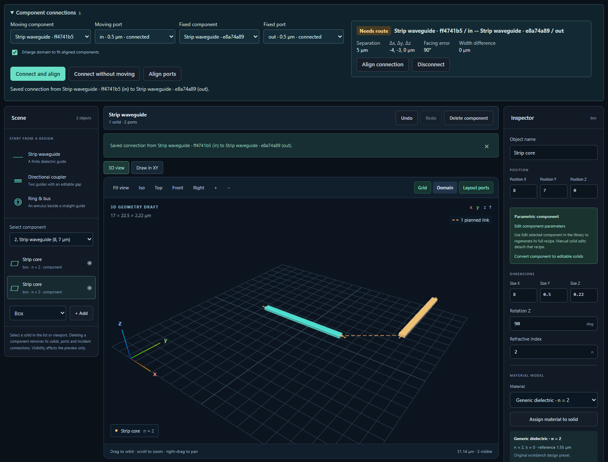
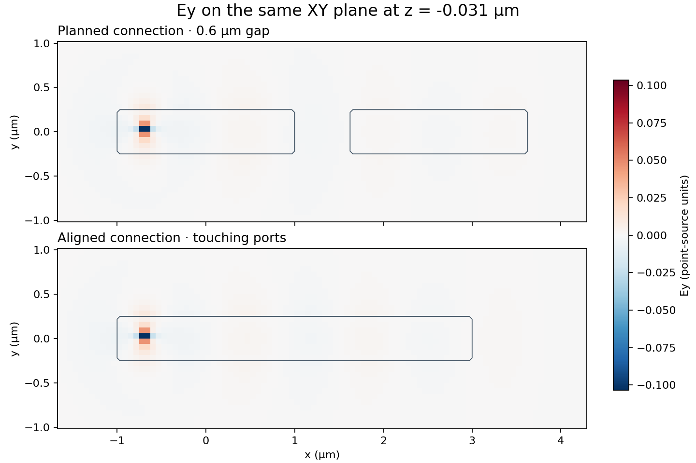

# Persistent circuit connections

A connection saves two named component ports in the design. Each port belongs to at most one connection. The saved endpoints follow their component IDs through regeneration, save, import and export. A connection can be planned while the ports are still physically apart.



The two strips above are 5 µm apart with a 90° facing error. **Align connection** moves the selected strip so its port meets the fixed one at x = 4 µm. The same saved ID follows the joint through undo, redo, disconnect, reload and JSON reimport. Seven Chromium scenarios verified this workflow with the library collapsed. [Aligned editor view](verification/v015-circuit-aligned.png) · [Import the planned design](verification/v015-circuit-planned-design.json) · [Import the aligned design](verification/v015-circuit-aligned-design.json) · [Browser verification](verification/v015-circuit-browser.json).

## Connect two strips in the editor

1. Open a strip in the 3D editor. Place a second strip from the component library.
2. Open **Component connections**. Select the moving strip’s **in** port and the fixed strip’s **out** port.
3. Choose **Connect without moving** to record a planned connection. Inspect its separation in micrometres, opposing-angle error and width. A dashed line shows the planned link in the viewport.
4. Choose **Connect and align** for equal-width ports. The moving component rotates and translates as one piece. The same connection ID survives. Coincident, oppositely directed, width-matched endpoints show an aligned joint.
5. Select **Disconnect** to remove the saved link. The solids retain their positions. Deleting an instance also removes its attached links. Undo restores the instance and the links together.
6. Export the design as JSON, Python or a Jupyter notebook. The stand-alone geometry program and notebook reproduce the saved geometry and connections. The notebook displays each pair’s current alignment.

**What the field solver sees.** Both Meep and FDTDX use the materials and physical solids. A gap remains a gap until geometry changes. The alignment check measures positions, directions and widths. A mode mismatch, radiation loss or manufacturing violation needs its own study. Automatic bend routing, hierarchy, process layers, Boolean operations, GDS round-trips and fabrication design-rule checks remain in the [product checklist](NEXT_CHUNKS.md).

## Measured fields of a connected pair

Two 2 µm strips were driven by the same Ey point current on NVIDIA. The first study had a 0.6 µm gap. The second moved the ends together, retaining the same connection ID. Both used 482,560 cells, 294 time steps and the same source, time window and coordinate axes. Alignment changed 640 displayed material cells. The relative L2 difference between the two final vector fields was 0.1717.



The planned and aligned device stepping times were 0.435 s and 0.694 s on the GPU event clock. Fresh executions of the aligned result’s Python program and unchanged notebook on NVIDIA reproduced all eleven field, material and coordinate arrays byte-for-byte. The saved connection also matched in both offline design programs. These dipole fields measure the response of the two layouts. Guided-port transmission requires a separate calibrated port measurement. [Field and timing verification](verification/v015-circuit-gpu-fields.json).

Unpack the design archive and import `geometry.json` in the editor to inspect the named ports. Each field archive includes the measured arrays and an editable program and notebook so you can repeat the run locally. [Connected design](https://github.com/srinjoyganguly/IsoPhotonIX/releases/download/v0.13.0a1/connected-strip-design-v0.13.0a1.zip) · [Separated-strip field study](https://github.com/srinjoyganguly/IsoPhotonIX/releases/download/v0.13.0a1/planned-strip-gpu-fields-v0.13.0a1.zip) · [Aligned-strip field study](https://github.com/srinjoyganguly/IsoPhotonIX/releases/download/v0.13.0a1/connected-strip-gpu-fields-v0.13.0a1.zip).

## Work with an exported design

The Python program contains the full editable design in `GEOMETRY`. From the unpacked design archive, use the bundled helpers to inspect a saved pair or align it. The same helpers are included in finite-layout field study exports.

```python
from geometry import GEOMETRY
from workbench_runtime import connect_ports, connection_status, disconnect_ports

edge = GEOMETRY["connections"][0]
a, b = edge["a"], edge["b"]
aligned = connect_ports(
    GEOMETRY, a["component_id"], a["port"], b["component_id"], b["port"],
    align=True, fit_domain=True,
)
print(connection_status(aligned))
disconnected = disconnect_ports(aligned, edge["id"])
```

Version 1 and earlier version 2 documents open with their original geometry. Existing drafts retain their old representation until the first saved connection. The optional `connections` array belongs to version 2. Import rejects dangling endpoints, duplicate connection IDs, self-connections and a second link on an occupied port.
