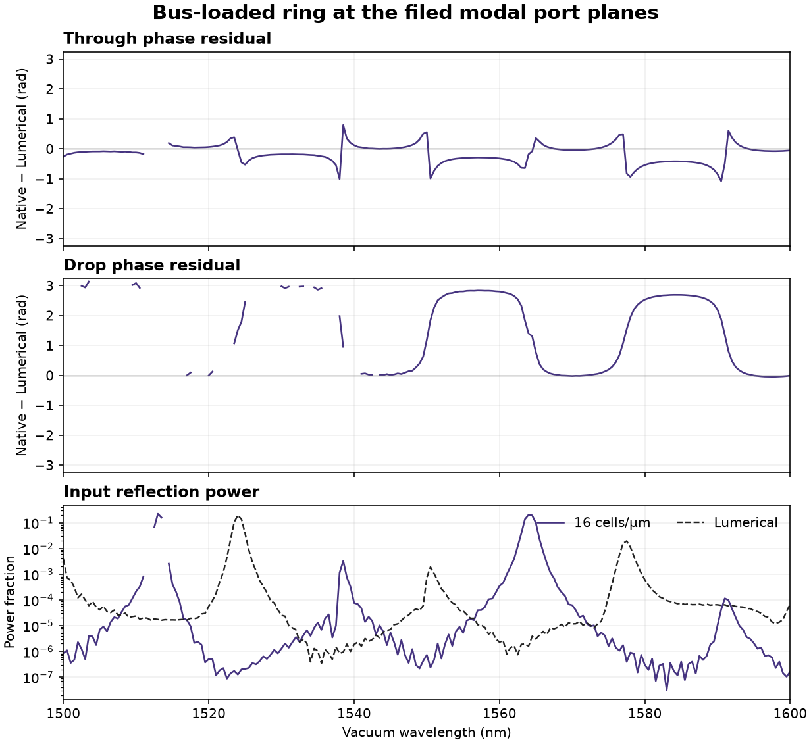

# Complex port measurements

## What the comparison measures

We report power as a fraction of incident power. A phase difference is in radians. Ring reflection is S11, through is S31, drop is S21, and the add-side return is S41 in the Lumerical file. The grating uses S11 for reflection into the reciprocal incident beam and S21 for the fundamental output guide. Scattered radiation outside that beam does not contribute to S11.

The ring and grating files supply magnitude and unwrapped phase in radians. The comparison interpolates in their native frequency coordinate. The native transform weights the recorded fields by exp(+iωt). Adding an outward length L at a port adds +βL to the transfer phase. The code determines the propagation direction and plane positions from the setup. It does not estimate an offset by fitting the commercial spectrum. [Ansys file convention](https://optics.ansys.com/hc/en-us/articles/360036618513-S-parameter-file-formats-and-usage) · [Ansys port normalization](https://optics.ansys.com/hc/en-us/articles/360034382554-Ports-FDTD-Simulation-Object)

The coupled ring has a measured straight reference. Its complex forward transfer supplies the numerical propagation constant at each sampled wavelength. Its independent transverse mode index resolves the integer number of phase turns. We extend both leads to the public port planes at |x| = 4.2 µm. The central frequency saved in the Lumerical project corresponds to 1548.3871 nm. For that frequency we reflect the native layout in y to match the upper launch bus, translate the core centre in z, apply the polar-E and axial-H reflection rules, and compare the two power-normalized TE bases on each native aperture. The same basis sign on all four ports cancels in their launch ratios. The central absolute phase comparison requires the flux-normalized reciprocal overlap magnitude and the ratio of captured to full filed modal power both within 0.05 of one, and a basis phase difference <0.01 rad at both ports. The original filed power is integrated on its nonuniform grid. The resampled ratio is 98.35% at the r16 launch and 99.16% at r20. We interpolate between adjacent native samples around the filed mode wavelength. Ansys explicitly used that one central expansion mode at all 500 frequencies. A separate broadband calculation therefore reprojects the archived time-domain field overlaps through one fixed native profile interpolated at the central wavelength. It applies the full-band phase gate, compares to the unwrapped vendor S file, and measures the difference to our usual frequency-specific bases. The overlap test establishes a common gauge at all frequencies in this fixed-mode control. [Lumerical ring project and S file](https://optics.ansys.com/hc/en-us/articles/360042800213-Ring-resonator-getting-started-Final-parameter-extraction) · [Filed port geometry and modes](verification/v013-ring-project-audit.json)

For the grating we use the actual DFT of the independently measured incident fields. A real square root of the incident flux alone retains the launch-pulse phase. For the fiber, the input phase is fixed by interpolating Ey at the axis of the recorded LP01-like beam. We normalize the output by this complex phase and the square root of received incident flux. We subtract the independent incident E/H fields before projecting reflection onto the reciprocal beam. That bilinear overlap contains twice the incoming phase. Each mesh has its own snapped detector positions. The fiber and guide propagation lengths register the output to the filed z and x planes, using the LP01 propagation constant and native frequency-specific guide mode index. The fiber axis on that z plane is about 62 nm from the filed port's x centre. The public FSP marks its saved fiber basis invalid. Only the positive-Ey workbench convention is established at the input. [Lumerical grating project](https://optics.ansys.com/hc/en-us/articles/360042305334-Grating-coupler) · [Filed grating mode audit](verification/v013-grating-port-basis.json)

For the Tidy3D grating, the local experiment uses a Gaussian beam in air. From the reference E/H fields we separate downward propagating TE/TM components through 80° and propagate them to a single physical point on every mesh. The complex guide amplitude and reciprocal-beam reflection then share a fixed phase convention. This finite-aperture estimate excludes grazing and evanescent components. The published ring and grating notebooks calculate squared mode amplitudes and save plots. Their saved outputs do not contain numerical complex monitor arrays for the plotted full-device experiments. Both task IDs printed by the pinned notebooks returned HTTP 401 from the official task-details endpoint when accessed without credentials on 6 November 2026. We compare their published power and report native phase sensitivity separately. [Signed-out access receipt](verification/v014-tidy-phase-availability.json) [Tidy3D ring](https://www.flexcompute.com/tidy3d/examples/notebooks/RingResonator/) · [Tidy3D grating](https://www.flexcompute.com/tidy3d/examples/notebooks/GratingCoupler/)

## Qualification

- Squared powers and absolute complex differences remain meaningful through a null. Phase needs |S| ≥ 0.02 on both sides. Ring phase also needs an 80%-to-final duration phase change ≤0.05 rad at the wavelength and a qualified solver bin.
- For cross-frequency comparisons we use the principal argument of S(f₂)S(f₁)*. Absolute constant basis phase cancels. We exclude weak endpoints, vendor interpolation intervals with a large phase jump and adjacent increments above π/2 on either side. This is a modulo-2π phase increment, not an unwrapped group delay. Sparse 25 nm grating sampling can miss whole turns and fine structure. Near-null phase is left empty. The grating guide must settle in phase to 0.05 rad in its final two observation intervals. Only the final upper-plane E/H arrays were archived, so the grating reflection has a mesh-sensitivity check but no independent reflection-phase duration series.
- Mesh differences use the same physical geometry, port convention and common wavelengths. Weak-return qualification limits are 0.001 absolute power and 0.01 complex amplitude, taken from the earlier finite-height port controls. A finite measured difference bounds sensitivity for these meshes; continuum accuracy requires additional evidence.

## Reanalysis of the earlier native fields

The earlier Lumerical ring exact-area runs changed from +2.027 to −0.072 rad in through phase and from −1.056 to −0.014 rad in drop phase against the vendor at 1548.387 nm, going from 16 to 20 cells/µm. The fine-mesh overlap magnitude exceeded 0.9998 at all four ports. At 20 cells/µm the through powers were 98.61% local and 86.74% filed. Drop powers were 1.10% and 9.35%. A close phase at this one wavelength coexists with substantial power error and displacement of the resonances elsewhere. Across the fixed-mode band, through-phase RMS residual falls from 1.857 to 0.552 rad, while drop-phase RMS rises from 1.127 to 1.646 rad. Changing the native receiver to the fixed central basis changes through power by at most 0.36 percentage points at r20. Both return channels at the central wavelength were below the phase floor, and there are zero jointly qualified absolute return-phase bins in either baseline mesh. [Measured ring phase and powers](verification/v014-ring-phase-baseline.json)

For the earlier finite gratings the largest changes at common wavelength samples were as follows. Each difference compares the 12 and 14 cell/µm native meshes. Power is an absolute percentage-point difference. The Tidy3D row uses its own 50 µm taper and free-space beam; the Lumerical row uses the curved fiber-coupled layout.

| Physical geometry | Return power | Return complex amplitude | Return phase | Guide power | Guide phase |
| --- | ---: | ---: | ---: | ---: | ---: |
| Lumerical | 0.242 pp | 0.0443 | 0.547 rad | 8.46 pp | 0.839 rad |
| Tidy3D | 0.810 pp | 0.0350 | 0.233 rad | 3.76 pp | 3.078 rad |

The native Tidy3D guide phase can change substantially across a long propagation path despite a smaller power change. Both return amplitudes exceed the 0.01 mesh-change gate. [Lumerical grating measurement](verification/v014-grating-phase-baseline.json) · [Tidy3D grating measurement](verification/v014-grating-phase-tidy3d.json)

To reproduce from the repository root, download the original attachments linked above and use the registered FDTDX environment for scientific postprocessing.

```bash
python -m scripts.phase_component_comparison --component ring \
  --vendor-sfile FDTDtoINTERCONNECT.txt --vendor-ring-project ring_resonator.fsp \
  --output ring-phase.json \
  docs/verification/v013-ring3d-lumerical-r16-t3200-exact-area.json \
  docs/verification/v013-ring3d-lumerical-r20-t3200-exact-area.json

python -m scripts.phase_component_comparison --component grating \
  --output tidy-grating-phase.json \
  docs/verification/v012-grating3d-tidy3d-r12.json \
  docs/verification/v012-grating3d-tidy3d-r14.json
```


## Wall-tensor ring

For the 16-cell/µm wall-tensor run over 3200 µm/c, 236 of 241 acquired wavelengths qualified. Its whole-run status is false. Three of the excluded samples lie within the filed wavelength band. At 1548.387 nm the native-minus-filed through and drop phase residuals are +0.178 and +0.240 rad. The full-band fixed-profile RMS residual is 0.337 rad for through (197 phase-qualified bins), and 1.924 rad for drop (148 bins). Neither weak-return channel has a jointly phase-qualified bin in this run. The power traces and their differences remain available through those nulls. [Window, per-bin gates and all four ports](verification/v014-ring-phase-wall.json)


