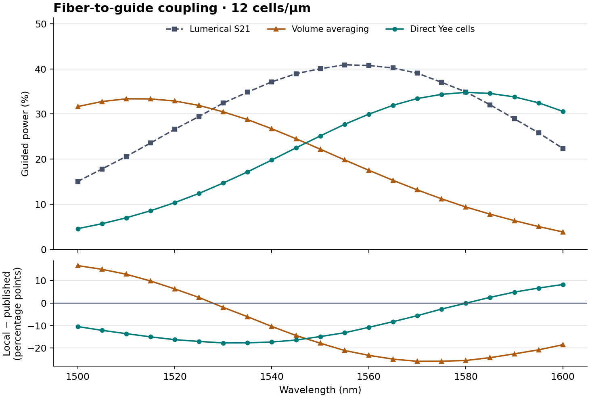

# Finite-width grating spectrum at 5 nm intervals

The experiment runs the published curved Lumerical grating twice on the same 12 cells/µm three-dimensional grid. In the first run, the solver samples a scalar material grid and averages adjacent cells to the electric-field locations. The second integrates the silicon directly at those locations. Both use the same physical chip, tilted LP01 fiber pulse, source phase delays, output aperture, PML and recorded wavelength band. Each case measures a new incident reference before the device.

FDTDX collects E and H phasors at **21 actual wavelengths from 1500 to 1600 nm**. At every wavelength the output guide has its own transverse modal basis. Local powers come from these acquisitions. The commercial powers are interpolated on wavelength from squared magnitudes in the original 50-frequency Lumerical S21 file, using its pinned SHA-256. The Tidy3D example has a different grating and source and keeps its original five reference samples. [Lumerical example](https://optics.ansys.com/hc/en-us/articles/360042305334-Grating-coupler) · [Derived comparison inputs](verification/v013-grating-dense-reference.json) · [Original notebook comparisons](GRATING_NOTEBOOK_REPLAYS.md).

## Measured powers and peaks

| Measurement | Volume averaging | Direct Yee-cell integration | Published |
| --- | ---: | ---: | ---: |
| Guided power at 1550 nm | 22.210% | 25.149% | 40.027% |
| Peak on the 21-point grid | 1510 nm (33.37%) | 1580 nm (34.80%) | 1555 nm (40.90%) |
| Mean absolute difference, 21 points | 16.466 percentage points | 11.012 percentage points | Reference |
| Mean absolute difference, original five points | 16.233 percentage points | 10.652 percentage points | Reference |

The peak in the 50-sample published file is 1557.616 nm at 40.958%. The denser measured grid locates the local maximum only to the available samples. Switching the local material sampling moves the measured peak by +70 nm. The original five-point studies had peak samples at 1525 and 1575 nm respectively. These observations separate a peak-location error from agreement of the entire transfer spectrum. [Full numerical comparison](verification/v013-grating-dense-comparison.json).

The strongest direct-cell sample is 22.38 nm above the published 50-point maximum; the volume-average sample is 47.62 nm below it. At 1550 nm the direct-cell run is still 14.88 percentage points below the commercial result. Its 11.01-point mean difference also exceeds the workbench’s 5-point engineering target. This 12-cell study measures spectral shape; a second dense mesh is needed to establish peak and power convergence. [Calibration targets](POWER_MISMATCH.md).



## Stability checks

The declared tolerance for a five-point anchor difference or truncated-window sensitivity is 0.25 percentage points. For each truncated-window check, the incident power and complex output amplitude are independently taken from earlier native detector snapshots. The reconstructed efficiency uses the same normalization as the final spectrum.

- **Volume averaging**. The largest difference from the earlier, independent five-point acquisition at a common wavelength is 0.00000 percentage points. Removing the last one or two observation windows changes the spectrum by at most 0.01770 and 0.03286 points. Anchor gate: pass. Window gate: pass.
- **Direct Yee-cell integration**. The largest difference from the earlier, independent five-point acquisition at a common wavelength is 0.00000 percentage points. Removing the last one or two observation windows changes the spectrum by at most 0.03216 and 0.04489 points. Anchor gate: pass. Window gate: pass.

Direct integration changes the numerical silicon/oxide interfaces throughout the curved grating and access guide. It can change the phase accumulated per period and the guided mode used for readout. The observed peak shift is the effect of that combined change in this local model.

At 1550 nm the native output strip mode indices are 2.36858 and 2.45725. Holding the volume-average electromagnetic fields fixed and projecting onto the direct-cell mode changes the 1550 nm transfer by +0.0535 percentage points. Holding the direct-cell fields fixed and using the volume-average mode changes it by -0.2004 points. This readout control separates changes from the two local port-mode bases from changes in the actual evolved chip fields. The calculation still uses fixed central material indices and a uniform mesh with 1.2 cells across the nominal 100 nm etch. [Material, fiber and port diagnostics](GRATING_POWER_DIAGNOSIS.md).

Across these observation windows, the peak sample ranges from 1510 to 1515 nm for volume averaging, and from 1580 to 1580 nm for direct Yee cells. Adjacent samples on a broad maximum can exchange order even with a small change in power.

The device observation durations are 1141 and 1201 fs. Their inverse-duration scales at 1550 nm are 7.02 and 6.67 nm. Evaluating the settled finite pulse response at 5 nm spacing samples the broad grating peak more closely; it does not by itself qualify a resonance narrower than the observation window supports.

## Reproduce locally

Use the installed workbench with an explicitly selected NVIDIA worker. The two commands differ only in material sampling. A new output directory is required for each invocation.

```bash
isophotonix calibrate grating-3d --solver fdtdx --device gpu --geometry-3d lumerical --resolution 12 --grating-spectrum dense --output dense-volume
isophotonix calibrate grating-3d --solver fdtdx --device gpu --geometry-3d lumerical --resolution 12 --grating-spectrum dense --grating-material-model direct-yee --output dense-yee
```

The resource check compiled both reference and device detector shapes for each material model on the RTX 3080 Ti Laptop GPU. The measured/compiled budget requires 6761 MiB free including reserve. The recorded 12-cell route checks available memory immediately before acquisition. [Memory calculation](verification/v013-grating-dense-memory.json).

- **Volume averaging**. The compact companion contains the exact plotted field and measured powers. The full raw NPZ retains every upper-plane field at all 21 wavelengths. [Numerical receipt](verification/v013-grating3d-lumerical-dense-volume-average-r12.json) · [Full native arrays](https://github.com/srinjoyganguly/IsoPhotonIX/releases/download/v0.12.0a2/grating-lumerical-dense-volume-average-3d-gpu-r12-v0.12.0a2.npz) · [Captured Python, notebook and results](https://github.com/srinjoyganguly/IsoPhotonIX/releases/download/v0.12.0a2/grating-lumerical-dense-volume-average-3d-gpu-r12-v0.12.0a2.zip).
- **Direct Yee cells**. The compact companion contains the exact plotted field and measured powers. The full raw NPZ retains every upper-plane field at all 21 wavelengths. [Numerical receipt](verification/v013-grating3d-lumerical-dense-direct-yee-r12.json) · [Full native arrays](https://github.com/srinjoyganguly/IsoPhotonIX/releases/download/v0.12.0a2/grating-lumerical-dense-direct-yee-3d-gpu-r12-v0.12.0a2.npz) · [Captured Python, notebook and results](https://github.com/srinjoyganguly/IsoPhotonIX/releases/download/v0.12.0a2/grating-lumerical-dense-direct-yee-3d-gpu-r12-v0.12.0a2.zip).
