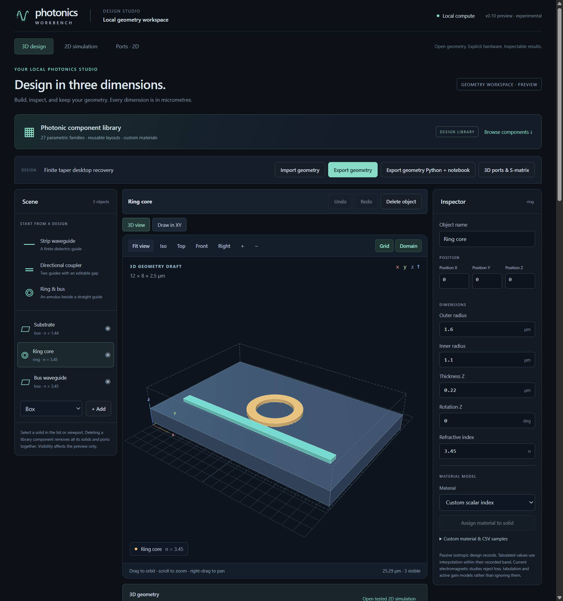

# Open IsoPhotonIX in a desktop window

After installing the application wheel in Linux or WSL, run:

```bash
isophotonix desktop
```

This opens the local editor in a dedicated Chromium application window. The
window uses the web application's 3D viewport, geometry tools, run history,
solver controls and exports. The launcher starts its server on
`http://127.0.0.1:8765` and uses a separate browser profile for the editor.
A local installation of Chrome, Chromium or Edge supplies the window.
The desktop route was exercised on WSL2 with Windows Google Chrome.

Use the same data directory, browser and port between sessions. The browser
stores draft geometry in its dedicated profile for that origin. Solver
settings and completed runs live in the workbench data directory. The desktop
and web commands share that run store by default and use it one at a time.
Import a geometry JSON to move a draft between the two browser profiles.
[Exporting designs and runs](REPRODUCIBLE_EXPORTS.md).

The launcher first tries a browser on the Linux PATH. On WSL it can also
locate Chrome or Edge in the standard Windows installation directories.
To use a particular browser or a different port:

```bash
isophotonix desktop --browser "/mnt/c/Program Files/Google/Chrome/Application/chrome.exe" --port 8765
```

Use `--data-dir` for a separate workbench state directory. For a WSL
data directory on a Windows drive the dedicated profile lives in
`.local/desktop-profile` under that directory. When the workbench data is
on the Linux filesystem and Chrome runs on Windows, the launcher uses a
per-store profile under the Windows user's local app data directory.
Linux-hosted Chromium uses `.local/desktop-profile` within the selected state.
[Chromium profile directories](https://chromium.googlesource.com/chromium/src/+/HEAD/docs/user_data_dir.md).

## Closing the window

Close the application window to finish. The launcher waits for an active
simulation to finish, then shuts down its local server. Interrupting the
launcher from the terminal instead requests shutdown immediately, including
cancellation of an active worker. An occupied port or data directory produces
an error before opening a new window. Browser storage is separate for each
profile and origin.

## Verification

A pip-installed launcher opened a Windows Chrome application window, rendered
three real WebGL objects, accepted a camera zoom, and restored a renamed
ring-and-bus draft after an offline restart. The browser's document requests
stayed on loopback.
Closing the window during an actual finite taper-port Meep solve let the job
finish and its results persist. The report includes completion status, device,
spectral validity, output hashes and the recorded response to duplicate
launches. [Desktop window and run evidence](verification/v010-desktop-window.json).



The qualified route is a Python launcher with a host browser, local web
server and existing numerical environments. Native Windows and macOS solver
packages, signed native installers, desktop shortcuts, and platform-wide
qualification of each host browser remain future packaging work.
