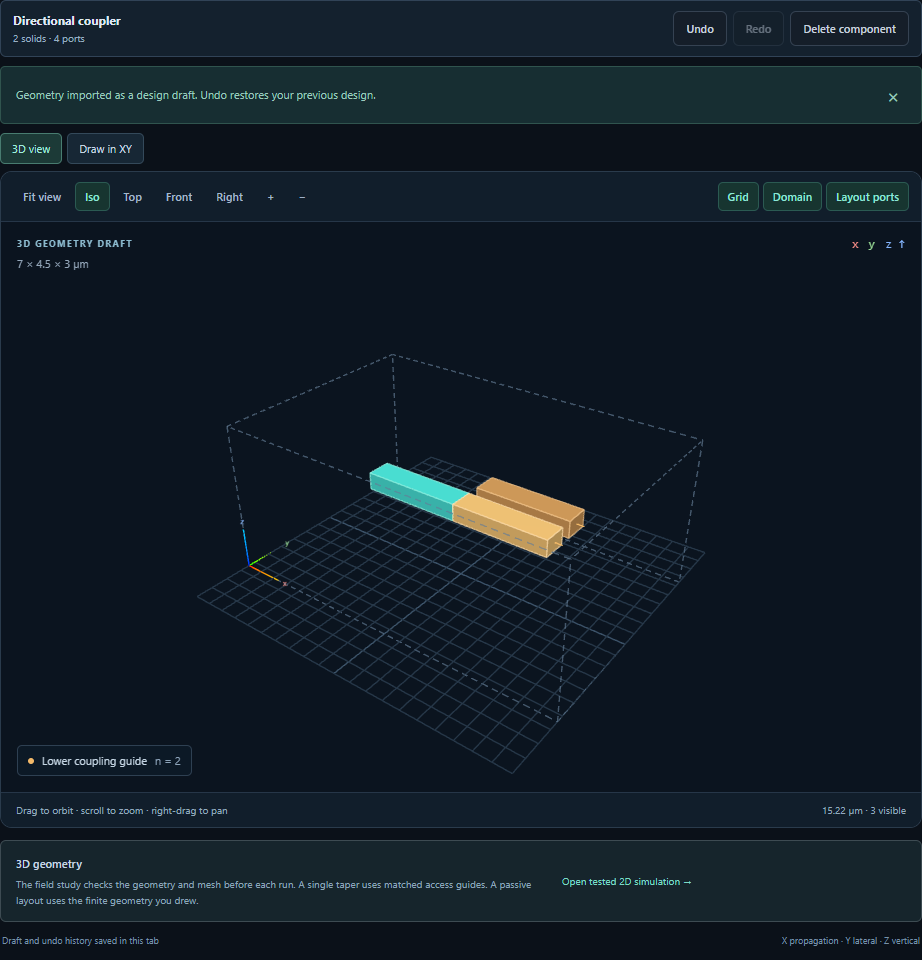

# Edit or remove part of a photonic design

Select a solid in the object list, the 3D view or the XY drawing. The toolbar
above the view shows the selection and the available **Delete**, **Undo** and
**Redo** commands. All visible solids of the selected instance are highlighted in both views.

- **Delete component** removes the complete selected library instance, its
  member solids and all its named ports as one edit. Other instances, their
  material order, and the reusable material definitions stay in the document.
  To remove just one solid from an instance, first choose **Convert component
  to editable solids**, then select the solid and use **Delete object**.
- **Undo** returns to the previous design and selection. **Redo** reapplies
  the edit. Making a different committed edit after undo starts a new branch.
  You can delete the last component and undo back to a runnable design.
- Use **Ctrl/Cmd+Z** for undo and **Ctrl/Cmd+Shift+Z** for redo. **Ctrl+Y**
  also redoes an edit. **Delete** or **Backspace** removes the selection when
  the editor owns keyboard focus. Text and numeric inputs keep their native
  editing behavior. Inside an unfinished XY sketch, point undo/redo and point
  deletion operate on that sketch. [XY drawing guide](XY_LAYOUT.md).
- The editor keeps up to 50 committed changes. A checkpoint in tab-local
  session storage can recover undo/redo on refresh when the autosaved document
  still matches. The 2 MiB checkpoint prioritizes nearby undo/redo states.
  With storage unavailable or the byte limit reached, fewer edits may survive
  a refresh. Export JSON to keep a portable copy.

## Join components by their named ports

Place two or more port-bearing library components in the design. Open **Photonic
component library → Align component ports**. Select the moving component and
port, then a fixed component and port. Choose **Align ports**. This operation
preserves instance IDs, every object and port, and material precedence. It
translates the component in XYZ and rotates around Z so that the two endpoints
coincide and their outward directions oppose one another. The operation is one
undo step. **Enlarge domain to fit aligned components** explicitly permits
domain growth when needed.

Alignment requires equal port widths. An already occupied target or a move that
would break an existing endpoint alignment is rejected. The saved design
contains the resulting physical coordinates. The endpoints can be moved apart
in later edits. This geometry check does not measure optical overlap, coupling,
loss, cross-sectional material compatibility or clearance elsewhere in the
circuit. Choose the appropriate simulation to measure those quantities.

The JSON, Python and notebook design exports preserve a joined layout or an empty scene. [Verified exports](verification/v010-edit-geometry-exports.json). The
exported Python helper exposes the same transform as the editor:

```python
from workbench_runtime import align_ports

geometry = align_ports(geometry, moving_id, "lower_in", fixed_id, "out", fit_domain=True)
```

[Browser commands and refresh recovery](verification/v010-edit-history-browser.json) · [Point editing checks](verification/v010-sketch-history-browser.json) · [Nine real field runs](verification/v010-edit-fields.json) · [Six numerical Python/notebook replays](verification/v010-edited-run-exports.json).


