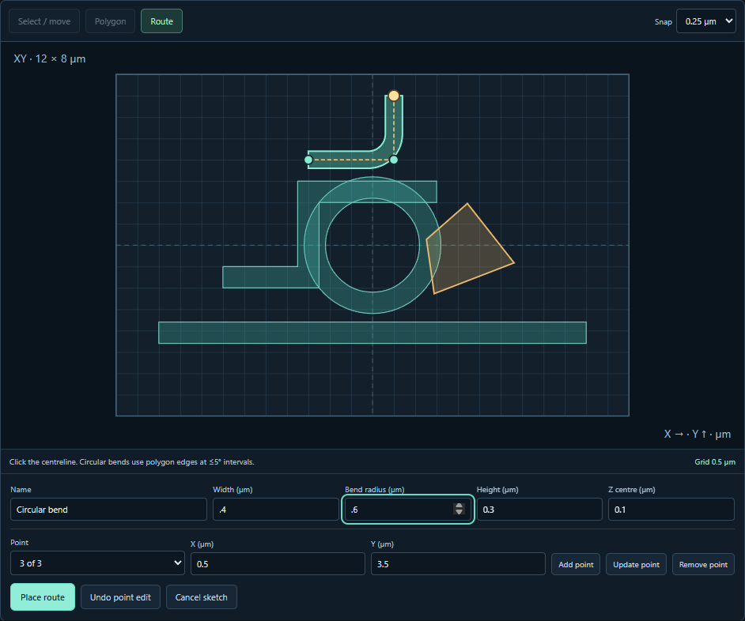

# Finite-layout fields and XY sketching

Use **3D design → XY sketch** to draw on the physical layout. Click points for
a polygon prism or a guide centerline. Set the guide width and thickness. Use
sharp joins or a circular corner radius. The preview shows the sampled
boundary before committing it to the scene. Grid snapping applies to pointer
coordinates. Typed coordinates retain their entered values. Undo the last
point, cancel a draft, or commit a shape as one document edit. Select and
drag to move a solid or an intact component, including its named port positions.
You can reopen a polygon outline for vertex edits. [Drawing controls](XY_LAYOUT.md).

The catalog has 27 families. A single, centered library taper defaults to its
matched-access-guide study. Other version-2 layouts default to the finite scene.
For a single component, **Open tested … field setup** loads its measured
dimensions, mesh and dipole position into a new undoable design. The service
checks that its compiled permittivity digest still matches the recorded run.
Select **Finite layout · local Ey dipole** explicitly to use this model on a
taper or an older primitive design. **Open finite coupler example** loads two
finite parallel guides. Set the dipole position in µm and choose a solver and
device. Inspect the Ex, Ey, Ez and material slices from the completed run.
Both study settings and saved results export as executable Python/notebooks.

## What the electromagnetic calculation represents

Both solvers consume the complete saved geometry. Boxes, cylinders, rings,
extruded polygons and holes support Z rotations and translations. Each cell
centre samples the shape. Later solids take precedence in an overlap. A void
in a polygon reveals the underlying material. Editing or regenerating a component
preserves its position in the material stack. [Overlap and export check](verification/v09-overlap-edit.json).
Hidden objects still participate.
The computational cell grows as needed for homogeneous cladding and six PML
faces. Every finite guide ends inside the cell. Changes to physical dimensions
or materials create a new study.

The impressed Ey point current drives a ramped sinusoid. The GUI shows its
applied grid position. Recordings use solver-specific source units. The
near-source field depends strongly on grid spacing. These volumes answer where
the field is at the recorded instant. A guided input, normalized output power,
resonator linewidth or lasing prediction needs its own excitation and monitors.

Only constant real isotropic indices in [1,5] participate. Geometry checks
reject shapes or holes that vanish on the requested grid. Every solid must
span at least two cells in Z. The study requires ten cells per shortest
material wavelength, eight per PML and a one-cell source clearance from PML.
The caps are 128 solids, 1.2 million cells and 1.2 billion cell updates.
Minimum checks protect against obvious sampling errors. They do not establish
mesh convergence for a narrow slot, sharp corner or resonant cavity.

Meep uses the common piecewise-constant permittivity with subpixel averaging
off and retains the input raster beside its native sampled dielectric. Values
within homogeneous 3×3×3 neighborhoods are checked independently against the
placed material. FDTDX compares its entire initialized scalar permittivity
grid with the common raster and verifies the JAX device before and after
time evolution. Both retain actual coordinates and the source/model settings.

## Verification

- All 27 families completed real Meep CPU field runs. The record includes
  each geometry override, grid, field digest, native material check and field
  peak at least 0.6 µm from the source. Four families used explicitly modified
  dimensions to fit their etches or extent in the local budget. [Family runs](verification/v09-family-fields.json)
- The finite coupler completed in the browser with Meep CPU, FDTDX CPU and
  FDTDX NVIDIA. All nine plane/component canvas samples were checked against
  saved fields on each target. FDTDX CPU and GPU used the same material grid.
  Their full electric-field relative L2 difference was 1.86 × 10⁻⁶.
  [Meep](verification/v09-layout-browser-meep-cpu.json) · [FDTDX CPU](verification/v09-layout-browser-fdtdx-cpu.json) · [FDTDX GPU](verification/v09-layout-browser-fdtdx-gpu.json) · [Repeatability](verification/v09-layout-cpu-gpu.json)
- All three downloaded numerical exports reran their actual workers in Python
  and in an executed Jupyter notebook. All saved array bytes matched for those
  six executions. [Replay record](verification/v09-layout-exports.json)
- An exported hand-drawn scene with a substrate, ring, bus and edited contours
  completed a separate Meep run at 3 µm. Its saved geometry matched the
  browser export exactly. [Sketch solve](verification/v09-sketch-field.json) · [Sketch interaction](verification/v09-sketch-browser.json)
- All 20 original v0.7 generators matched archived geometry in 60 comparisons.
  All 27 families opened in the browser and reproduced their geometry in
  standalone design code. [Compatibility](verification/v09-legacy-library-audit.json) · [Design replays](verification/v09-library-exports.json)

The [vendor review](VENDOR_COMPONENT_COVERAGE.md) separates geometry coverage,
device observables and high-fidelity simulation requirements. The
[published-example comparisons](COMPONENT_REFERENCE_CHECKS.md) use independent
local modal calculations for specific published quantities.

The seven additions were also run on FDTDX CPU and NVIDIA using the same
configurations as their Meep cases. All seven input material digests matched.
CPU/GPU native material arrays and coordinates matched exactly. The largest
electric-field relative L2 difference across the seven was 2.81 × 10⁻⁶ on
the displayed grid. [FDTDX CPU cases](verification/v09-new-family-fields-fdtdx-cpu.json)
· [NVIDIA cases and comparisons](verification/v09-new-family-fields-fdtdx-gpu.json).
