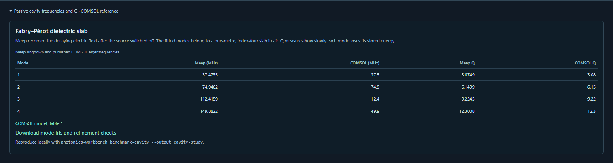

# Passive Fabry–Perot cavity

This reference case measures the frequencies and quality factors of four
longitudinal modes in a 1 m lossless dielectric slab of index 4 in air. The
published COMSOL model is uniform in its transverse direction and uses
normal incidence. We reduce that physical problem to one spatial dimension
and rotate the coordinate axes so Meep can evolve the transverse electric
field. COMSOL reports eigenfrequencies. Our numbers below come from a
time-domain Maxwell simulation after the excitation has ended.
[COMSOL model, Table 1](https://doc.comsol.com/5.5/doc/com.comsol.help.models.woptics.fabry_perot/models.woptics.fabry_perot.pdf).

| Longitudinal order | Meep frequency (MHz) | COMSOL (MHz) | Meep Q | COMSOL Q |
| --- | ---: | ---: | ---: | ---: |
| 1 | 37.47352 | 37.5 | 3.07489 | 3.08 |
| 2 | 74.94623 | 74.9 | 6.14988 | 6.15 |
| 3 | 112.41586 | 112.4 | 9.22452 | 9.22 |
| 4 | 149.88225 | 149.9 | 12.30080 | 12.3 |

Across these four rows the largest differences from COMSOL's rounded numbers
are 0.0707% for frequency and 0.1661% for Q. For an outgoing wave at either
interface the internal amplitude reflection coefficient is 0.6. The
round-trip pole condition gives the independent exact frequency
`f_m = mc/(2nL)` and quality factor `Q_m = −mπ/(2 log(0.6))`.
Against those unrounded values the largest relative differences are 0.00933%
in frequency and 0.00607% in Q. [Measured report](verification/v010-passive-cavity.json).

## Reproduce the measurement

With the local workbench and its Meep CPU runtime installed, run

```bash
photonics-workbench benchmark-cavity --output cavity-run
```

From a checkout with the prepared environment, the equivalent command is

```bash
.local/meep-conda/bin/python scripts/benchmark_passive_cavity.py --output cavity-run
```

The output directory includes the native time coordinates and signed electric
field for each run in `traces.npz`, plus the detailed `report.json`, an
independent `cavity.py` replay and a self-contained `cavity.ipynb`. Run
`python cavity.py --output second-run` with the Meep interpreter. For
Jupyter, choose a Meep-enabled kernel or set `MEEP_PYTHON` to the absolute
path of that interpreter before starting Jupyter. Each execution requires a
fresh output directory. A failed numerical tolerance produces a nonzero exit
status with the completed measurements available for inspection.
[Recorded raw traces](verification/v010-passive-cavity-traces.npz).

We executed both exported forms in separate runs. All twelve recorded arrays
(times and signed Ex for six simulations), all fitted poles and the report
matched the original byte for byte using the same Meep environment.
[Python and notebook replay checks](verification/v010-passive-cavity-exports.json).

## Physical and numerical checks

An off-centre broadband Gaussian electric current excites even and odd modes.
Meep samples Ex at a second point inside the slab every 0.125 units of 1 m/c.
The pulse ends at time 20. Each fit uses only later samples. We estimate the
complex poles of the freely decaying field by singular-value truncation of
two shifted Hankel matrices. We retain decaying positive-frequency poles between
20 and 166 MHz with amplitude exceeding 10⁻⁵ of the largest fitted amplitude.
The fit must resolve four poles. Frequency is the oscillation rate and Q is
the angular frequency divided by twice the amplitude decay rate. A complete
pole fit also reconstructs the measured trace to check its residual. The public
values enter only after estimating the poles.
[Meep time-domain measurement tutorial](https://meep.readthedocs.io/en/latest/Python_Tutorials/Basics/).

- Meep ran at 32, 64, 128 and 256 cells per metre. The final refinement
  changed frequency by up to 0.03065% and Q by up to 0.05151%.
- Two additional finest-grid runs varied one boundary setting at a time.
  Doubling the absorbing layer from 3 to 6 m changed Q by up to 0.000361%.
  Increasing the air gap from 2 to 3 m changed Q by up to 0.0000553%.
- Five fit variants per trace tested three observation windows and three
  matrix ranks. Their largest Q change on the finest baseline was 0.01239%.
  The largest relative field-fit residual across all thirty fits was
  0.00001825. [Detailed fits and tolerances](verification/v010-passive-cavity.json).

This case qualifies one passive longitudinal cavity measurement with Meep CPU.
Finite-width radiation, material loss, carrier dynamics, optical gain,
threshold and pump-dependent lasing require separate measurements and models.


