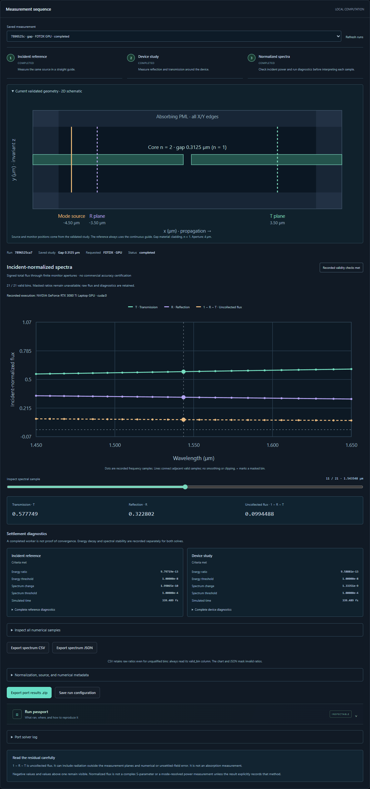

# Reference-normalized port measurements

The **Ports · 2D** workspace measures reflection and transmission of a straight
dielectric slab or a centred gap. Each job runs an uninterrupted incident
reference and the requested device using the same selected execution target.
It exports actual signed fluxes, normalization, settling diagnostics and an
immutable configuration.

This is a dedicated **two-dimensional model invariant along z**. It does not
add calibrated ports to the finite-height 3D editor. The measured quantities
are total power through finite cross-sections, not complex modal S-parameters.



This original application screenshot shows the browser-tested 0.3125 µm gap.
The canonical numerical qualification below uses the bundled 0.25 µm gap.

## Run a measurement

1. Start the local application using [SETUP.md](SETUP.md), then open
   **Ports · 2D**.
2. Choose **Open straight-guide validation** for a calibration check, or the gap
   example for a nontrivial device. The geometry preview identifies the source
   and measurement planes; it is not a computed field image.
3. Review geometry, materials and wavelength sampling. **Advanced numerics and
   settling** exposes resolution, PML, time cap and the two independent stopping
   tolerances. Validation must accept the current study.
4. Explicitly select an available execution target. A readiness probe checks
   the port-specific runtime; it is separate from numerical qualification.
   GPU failure does not start a CPU retry.
5. Choose **Run reference + device**. The interface reports the reference,
   device and normalization stages. Cancellation stops the active job without
   claiming a completed spectrum.
6. Inspect the valid-bin count, both runs' settling diagnostics, incident flux
   and the signed R/T curves. Worker completion alone does not make every bin
   usable. Negative values and values above one remain visible.
7. Export spectrum CSV/JSON or the complete result ZIP. **Save run
   configuration** saves the settings of that completed job. Later edits do
   not change its measurements; **Saved measurement** reopens recorded runs.

The bundled configurations select Meep CPU explicitly:

```bash
.venv/bin/python scripts/run_simulation.py examples/ports-straight.json --output runs/ports-straight-01
.venv/bin/python scripts/run_simulation.py examples/ports-gap.json --output runs/ports-gap-01
```

Output directories must be new. The launcher resolves the configured solver
interpreter and starts an isolated worker. These commands use existing managed
environments; they are not a fresh-installation guarantee. Configuration files
use `schema_version: 3`, `study_type: "waveguide-ports-2d"` and
`device_kind: "straight"` or `"gap"`. A straight study requires `gap_um: 0`;
the adapter does not silently discard a nonzero gap.

## Canonical physical model

| Parameter | Default gap study |
| --- | --- |
| Domain X × Y | 12 × 6 µm; invariant z |
| Centred core width | 0.625 µm |
| Core / cladding refractive index | 2.0 / 1.0 |
| Gap | 0.25 µm along x, centred at x = 0, filled with cladding |
| Wavelength interval | 1.45–1.65 µm |
| Spectral samples | 21, uniform in frequency; exported in increasing wavelength |
| Resolution | 32 cells/µm; 384 × 192 x-y grid |
| PML | 1 µm on x/y faces |
| Source / reflection / transmission x | −4.5 / −3.5 / +3.5 µm |
| Source and monitor aperture | 4 µm along y, between transverse PML inner faces |
| Energy decay / spectrum stability | 10⁻⁸ / 10⁻⁴ |
| Maximum additional time after source | 1000 fs per stage |

Materials are real, isotropic, lossless and nondispersive. The straight guide
continues through the longitudinal PML. The gap replaces only its central
segment with cladding. Source and monitors remain in uniform guide sections.

Meep launches an Ez-polarized, even-y fundamental mode toward +x using
`EigenModeSource`, band 1 and `ODD_Z + EVEN_Y`. Its profile is solved at the
pulse centre frequency. A finite-band pulse does not guarantee a pure mode at
every frequency; the fixed-profile approximation and finite aperture remain
part of this study. [Meep eigenmode-source guidance](https://meep.readthedocs.io/en/latest/Python_Tutorials/Eigenmode_Source/).

For Meep, `fmin = 1/wavelength_max_um`, `fmax = 1/wavelength_min_um`,
`fcen = (fmin + fmax)/2`, and Gaussian `fwidth = 2*(fmax-fmin)` in c/µm.
Cutoff 6 gives approximately 239.416 fs source support at the defaults; actual
times are recorded. The centre wavelength is approximately 1.54355 µm because
the sampling is symmetric in frequency. [Meep GaussianSource API](https://meep.readthedocs.io/en/latest/Python_User_Interface/#gaussiansource).

## What R and T mean

Every measurement uses a new straight-reference solve with matching grid,
materials, source, boundaries and monitor locations. The incoming reference
flux at the left monitor is the denominator. At that monitor, the device solve
subtracts the reference's complex Fourier-transformed E/H fields before
evaluating reflected flux. Subtracting two power numbers would not remove the
incident/reflected interference term. This follows Meep's documented reference
and subtraction workflow. [Meep transmission tutorial](https://meep.readthedocs.io/en/latest/Python_Tutorials/Basics/#transmittance-spectrum-of-a-waveguide-bend),
[Meep flux API](https://meep.readthedocs.io/en/latest/Python_User_Interface/#flux-spectra).

All planes have +x normals:

```text
R = -signed_reflected_flux / incident_reference_flux
T = transmitted_device_flux / incident_reference_flux
uncollected_fraction = 1 - R - T
```

R and T are dimensionless. Raw flux and field values retain the solver's source
normalization; they are not calibrated W, W/cm or V/m measurements. The actual
straight-reference output/input ratio is also retained and is not forced to 1.

The residual can contain lateral radiation, finite-aperture effects and
numerical error. It is **not absorption**: these materials are lossless. No
clipping, fitted amplitude factor or phase adjustment is applied to improve a
curve. Mode-resolved power, complex S-parameters, modal purity, full radiation
accounting and finite-height 3D ports require additional work.

## Settling and invalid samples

Meep checks whole-cell electromagnetic energy and changes in the two monitor
spectra every 5 µm/c, approximately 16.678 fs. After source turn-off, two
successive checks must satisfy both independent criteria:

- `decay_by`: energy relative to the largest sampled energy; default 10⁻⁸.
- `spectrum_tolerance`: largest per-bin absolute flux change divided by the
  incident-power scale; default 10⁻⁴. During the reference solve, the current
  transmitted reference spectrum supplies that scale. A small denominator floor
  prevents a weak bin from creating a meaningless division.

The stage stops at its time cap even when these criteria fail, and reports
`settled: false`. The saved metadata includes measured ratios, thresholds,
source end time, simulated time, stopping reason and wall time. These are
temporal diagnostics, not mesh or boundary convergence certificates. Meep also
documents separate energy/field/DFT stopping approaches; this adapter records
its own combined criterion explicitly. [Meep run and stopping API](https://meep.readthedocs.io/en/latest/Python_User_Interface/#run-and-step-functions).

A bin is valid only when both stages settled, its positive incident flux exceeds
10⁻⁶ of the largest incident bin, and its ratios are finite. `spectra_valid`
means every bin passed these checks. It does not mean commercial agreement or
engineering accuracy.

The JSON API returns `null` ratios for invalid bins, so plots leave a gap rather
than drawing zero. CSV retains finite computed ratios even when `valid_bin` is
`false`; undefined ratios are blank. Always filter on that column before using
CSV values as measurements. NPZ preserves raw values and flags, including
undefined ratios as NaN. An unsettled result can be inspected without being
presented as a qualified measurement.

## Files and local API

| Artifact | Contents |
| --- | --- |
| `config.json` | Exact versioned study, solver and selected target |
| `metadata.json` | Source, monitors, normalization, actual device, versions, times and both settling records |
| `arrays.npz` | Actual final-time `field=Ez[y,x]`, `epsilon[y,x]`, `x_um`, `y_um` |
| `spectra.npz` | Coordinates, incident/reflected/transmitted/reference-output flux, unclipped R/T/residual and `valid_bin` |
| `spectrum.csv` | The same scalar spectrum with mandatory validity flags |
| Passport, manifest and log | Reproduction details, original-file SHA256 checks and worker output |

The saved field is a late ringdown snapshot after the pulse, not a synthesized
steady-state pattern. It can be extremely small after successful decay. Its
actual saved time is `field_time_fs`. This increment does not save a port-study
time animation.

Meep's additional `*_dft_e` / `*_dft_h` arrays are exact **opaque native
FluxData streams**. They preserve reference, scattered and transmitted monitor
state in Meep's native order. They are not spatial field images or arrays indexed
by the exported wavelength axis. Reloading requires identical monitor,
processor and chunk layouts. [Meep FluxData contract](https://meep.readthedocs.io/en/latest/Python_User_Interface/#flux-spectra).

| Endpoint | Purpose |
| --- | --- |
| `GET /api/ports/example?kind=straight` or `gap` | Canonical executable configuration |
| `GET /api/ports/capabilities` | Independent readiness for mode/phasor studies |
| `POST /api/ports/validate` | Physical/resource validation, layout and assumptions |
| `POST /api/ports/jobs` | Submit an explicitly selected available target |
| `GET /api/jobs/{id}/spectrum` | Qualified JSON view with invalid ratios masked |
| `GET /api/jobs/{id}/spectrum.csv` | Raw scalar measurements and validity flags |
| `GET /api/jobs/{id}/export` | Audited numerical ZIP and passport |

## Numerical qualification status

[Meep qualification evidence](verification/meep-ports.json) records seven actual
reference/device pairs, exact configurations, solver versions, times and
normalization. The canonical straight pair gives R approximately zero and T
between 0.999627 and 1.000000. The gap gives R from 0.25359 to 0.29201 and T from
0.63642 to 0.68559 across the band. A forced timeout preserves its finite
numerical values while invalidating every bin.

| Change from canonical Meep grid | Maximum absolute change in T |
| --- | ---: |
| Resolution 32 → 48 cells/µm | 0.0016914 |
| Resolution 32 → 64 cells/µm | 0.0022781 |
| Resolution 48 → 64 cells/µm | 0.0005867 |
| PML 1 → 1.5 µm with fixed interior/source/monitors | 0.00000558 |
| Stricter temporal settling | 0.0000000587 |

These are measured sensitivities for this model, not rigorous errors relative
to an exact answer. The 64-cells/µm case exceeds the interactive resolution and
cell limits; stricter energy decay and forced 5 fs timeout are also direct-adapter
qualification cases outside GUI bounds. Their settings are retained rather
than advertised as selectable GUI configurations. The report also retains an
unsuccessful early cutoff-5 diagnostic that informed the current cutoff-6 pulse.

### FDTDX CPU and NVIDIA route

[FDTDX qualification evidence](verification/fdtdx-ports.json) records six actual
reference/device pairs, including CPU/GPU gap studies, a straight-guide check,
grid refinement, a longer-time diagnostic and a deliberately insufficient
ringdown. It records exact configurations, package versions, signed spectra,
source modes, settling histories and SHA256 hashes of the retained arrays.
These runs used FDTDX 0.6.2, JAX/jaxlib 0.10.2 and local Tidy3D 2.11.2 in an
existing WSL environment.

To use the same launcher, save a copy of either bundled configuration with
`solver: "fdtdx"` and an explicit `device: "cpu"` or `"gpu"`. GPU evolution
requires visible NVIDIA CUDA hardware. A hidden-GPU check failed with
`CUDA_ERROR_NO_DEVICE` and the explicit message that CPU fallback is disabled;
no simulation started in that check.

FDTDX uses three periodic z cells to represent the invariant slab. Its
`ModePlaneSource` calls the installed **local CPU mode solver** even for a GPU
job; no Tidy3D account or remote service is used. Material arrays, fields and
time evolution use the requested target, and actual placement is verified.
This CPU preparation is disclosed in progress text and saved metadata. The
mode is selected using `mode_index=0`, `filter_pol='tm'`: FDTDX's transverse-axis
convention maps this filter to physical Ez here. The adapter checks the Ez
electric-field L2 fraction and invariance along z; its canonical effective index was
1.8167534. [FDTDX mode-source API](https://fdtdx.readthedocs.io/en/stable/api/fdtdx.ModePlaneSource.html).

The Gaussian envelope has `sigma_time = 1/(2*frequency_span_hz)`, peaks at six
sigma and switches off at twelve sigma, giving 239.416 fs default support.
This matches the stated pulse duration and envelope width across the two
adapters; their discrete electromagnetic injection operators still differ.
[FDTDX pulse API](https://fdtdx.readthedocs.io/en/stable/api/fdtdx.GaussianPulseProfile.html).

Each `PhasorDetector` accumulates all six E/H components every step with pulse
scaling. In the inspected 0.6.2 implementation, exact interpolation co-locates
components at Ez Yee positions and averages adjacent H time levels. The adapter
integrates `0.5*Re(Ey*conj(Hz) - Ez*conj(Hy))` over y and averages the periodic
z samples; the shared arbitrary power scale cancels in the ratios. Reflection
uses device-minus-reference **complex fields before this product**. Online
stable documentation may describe a newer release; the installed source and
recorded versions define this tested implementation.
[FDTDX phasor API](https://fdtdx.readthedocs.io/en/stable/api/fdtdx.PhasorDetector.html).

Settling checks continue the same FDTDX forward update without resetting fields,
PML state or accumulated phasors. They begin approximately 50 fs after source
turn-off and repeat every 50 fs. The energy criterion is the maximum sampled
**non-PML** energy in the last 50 fs divided by the maximum over the run, with
samples approximately 1 fs apart. Unexecuted, zero-filled detector slots are
excluded. Spectral change is the maximum frequency-bin change in accumulated
flux between consecutive checks, divided by that monitor's current peak
absolute flux, then maximized over both monitors. Both criteria must pass;
the first check alone cannot establish spectral stability. These definitions
differ from the Meep diagnostics above and are exported explicitly.

| Actual FDTDX check | Observation |
| --- | --- |
| Straight GPU, 32 cells/µm | R = 0; T = 0.9996497–0.9999986 |
| Gap GPU, 32 cells/µm | R = 0.257904–0.298548; T = 0.629419–0.681184 |
| Same gap on CPU versus GPU | Maximum absolute R/T difference 1.79 × 10⁻⁷ |
| Gap resolution 32 → 48 cells/µm | Maximum absolute R change 0.0023315; T change 0.0021878 |
| Early stop versus earlier full 1239 fs run | Maximum absolute R/T change 5.96 × 10⁻⁸ |
| Deliberate 5 fs after-source cap | Both stages unqualified; every normalized bin invalid |

The canonical gap stages settled at 339.489 fs with energy ratios below 10⁻¹²
and spectral changes below 4 × 10⁻⁹. Observed two-stage wall times were about
100 seconds on CPU and 25 seconds on this RTX 3080 Ti Laptop GPU; these are
individual observations, not performance guarantees. CPU/GPU raw complex
monitor arrays also agreed to relative L2 below 3.68 × 10⁻⁷ without rescaling.

Mesh sensitivity remains larger than CPU/GPU differences. The cross-solver
curves are not identical, and this increment does not establish a converged
reference or commercial agreement. FDTDX PML/domain refinement is still absent.
The short-cap case intentionally bypasses the GUI's minimum time allowance;
the report distinguishes it from a selectable study. Its actual raw fluxes and
phasors remain saved, while normalized values are NaN and API ratios are null.

FDTDX also saves `reference-monitors.npz` and `device-monitors.npz`. Each stores
`reflection_phasors` and `transmission_phasors` indexed
`[frequency, component, x=1, y, z]`, with component order
`Ex,Ey,Ez,Hx,Hy,Hz`, ascending frequency coordinates, monitor y positions,
source E/H arrays and sampled energy/times. These monitor files use their own
ascending-frequency order; `spectra.npz` is sorted by increasing wavelength.
The `*_tail_phasors` arrays are cumulative differences between the final two
settling checkpoints, not instantaneous fields. A run ending before a second
checkpoint has zero tail placeholders and cannot claim spectral settling.

Final field exports retain raw Ez Yee samples at
`(i*dx, j*dx, (k+0.5)*dx)` with the middle periodic z cell selected. Material
lengths are rounded to voxel counts and centered lower indices are floored;
nonaligned input can shift a boundary by part of a cell. Requested dimensions,
actual voxel bounds and actual source/monitor coordinates are recorded.
The initialized permittivity grid is checked against that translation before
time evolution. These conventions must be considered when comparing the
subpixel-averaged Meep geometry with FDTDX.

## Application checks

The API regression suite checks signed normalization, invalid-bin masking,
settling evidence, exact frequency bands, configuration consistency, CSV
integrity, target rejection and hashes for all exported numerical files.
Synthetic test waves establish flux arithmetic only. Actual solver evidence
is recorded separately above.

The [browser verification instructions](browser-tests.md#guided-port-measurements)
exercise real Meep CPU and FDTDX CPU/GPU pairs and compare the plotted samples
and downloaded data against their saved results:

- [Meep CPU browser journey](verification/ports-browser-meep-cpu.json)
- [FDTDX CPU browser journey](verification/ports-browser-fdtdx-cpu.json)
- [FDTDX NVIDIA browser journey](verification/ports-browser-fdtdx-gpu.json)
- [Existing 2D/3D API and export regression](verification/ports-legacy-regression.json)
- [Original 2D browser journey](verification/ports-legacy-2d-browser.json) and
  [3D slices/comparison regression](verification/ports-legacy-3d-browser.json)

The deliberate masked-bin and HTTP-error fixtures test presentation and
recovery, not physics. The application build passed TypeScript and Vite checks;
the API suite passed 77 tests with three Meep numerical tests skipped in that
separate interpreter. The dedicated Meep port numerical tests passed in its
own runtime.
