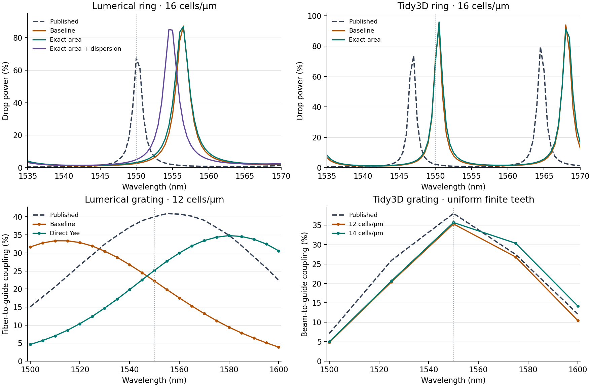

# Why the published and local powers differ

The latest fixed-geometry GPU refinements are in the [calibration checklist](CALIBRATED_COMPONENTS.md). At 1550 nm the 50 nm Lumerical grating reaches 38.79% against 40.03% filed, while the 62.5 nm Tidy3D grating reaches 34.60% against 38.02% read from its published figure. Both still change more than the two-percentage-point mesh limit. Replacing the output receiver alone changes those results by about 0.10 and 0.07 points. An independent slab propagation estimate explains a substantial part of the measured grating phase shift. [Etch, taper phase and receiver comparisons](GRATING_ETCH_REFINEMENT.md).

For the ring, resolving the straight 100 nm gap gives a mode splitting close to Lumerical’s published 0.109. The complete device remains sensitive to its round-trip phase. The original 24-cell wall update gives growing fields and its whole spectrum is excluded. The reciprocal wall update gives decaying fields and 241 qualified wavelength samples, but its central peak is displaced by 5.09 nm. Its small 1550 nm reflection coexists with a strong return at its shifted resonance. [Independent gap and bend modes](RING_GAP_MODES.md) · [Full-ring stability and optical results](RECIPROCAL_RING_STABILITY.md). The earlier baseline and material controls below retain their original meshes and numerical treatments.

The comparisons use physical wavelengths and incident guided power. No gain or wavelength offset is fitted to the vendor spectrum. Each candidate material or geometry change is measured against the unmodified workbench calculation at the same mesh. The published Tidy3D and Lumerical examples describe different devices.



The ring panels compare drop power near 1550 nm. The grating panels use actual detector samples. Each panel compares the same physical observable in its own vendor example.

## Where the ring power goes

The Lumerical text attachment contains the complex fundamental-mode amplitudes for every port. For excitation at port 1, we square the amplitude magnitudes and interpolate power onto the qualified workbench wavelengths. At 1550 nm the 24-cell/µm workbench ring and the published file give:

| Output | IsoPhotonIX | Published Lumerical |
| --- | ---: | ---: |
| Through | 96.369% | 9.392% |
| Drop | 2.890% | 67.442% |
| Reflection | 0.00086% | 0.07616% |
| Add side | 0.00006% | 0.08245% |

The dominant difference at this wavelength is routing between through and drop. The four guided powers account for about 99.26% locally and 76.99% in the published file. The remainder can include radiation, absorption, other fields or numerical/port error. The port data alone do not separate those contributions. The Ansys example discusses resonant backscattering and recommends testing the coupling-region mesh, vertical domain and observation time. [Ansys ring and S-parameter attachment](https://optics.ansys.com/hc/en-us/articles/360042800213-Ring-resonator-getting-started-Final-parameter-extraction) · [Hash-checked power measurements](verification/v013-power-diagnostics.json).

**The two spectra put 1550 nm at different places on a resonance.** The nearest published drop maximum is at 1550.092 nm, only 0.065 published linewidths from the target. The qualified workbench fit centers at 1558.713 nm, 2.81 local linewidths away. At its own nearest *sampled* peak, the local ring drops 82.0%, versus 71.5% at the published peak. The local fitted width is 3.10 nm versus 1.42 nm in the reference. Both the center position and the linewidth differ. Comparing peaks helps diagnose the fixed-wavelength mismatch; it does not establish their angular order or improve the fixed-wavelength result. [24-cell spectrum, native fits and wavelength masks](verification/v012-ring3d-lumerical-r24-t3200.json).

The same two central peaks move by −4.5 nm from 20 to 24 cells/µm while their spacing stays at 27.0 nm. For this geometry the 100 nm gap occupies only 2.4 cells at the finest mesh. At 16 cells/µm, widening the absorbing boundary or monitor aperture separately changed measured power by at most 0.00045. These controls place the first correction effort on optical phase and boundary sampling. They do not establish fine-grid convergence or isolate each loss channel. [Mesh](verification/v012-ring3d-lumerical-20to24-comparison.json) · [Boundary](verification/v012-ring3d-lumerical-pml-comparison.json) · [Aperture](verification/v012-ring3d-lumerical-aperture-comparison.json).

The Tidy3D ring demonstrates why a single favorable wavelength is insufficient. At 1550 nm the 20-cell result drops 1.67% versus 2.16% from the digitized reference, yet the mean absolute drop-power difference across the common band is 17.51 percentage points. The 16-cell ring drops 71.98% at that same wavelength. [Tidy3D add/drop example](https://www.flexcompute.com/tidy3d/examples/notebooks/RingResonator/) · [Measured mesh sensitivity](verification/v012-ring3d-tidy3d-mesh-comparison.json).

The filed Ansys monitor provides total drop flux as well as the separate fundamental-mode S-parameter attachment. At 1550 nm the former gives **75.46%**, the latter **67.44%**. The comparison above uses the latter because the workbench projects onto that guided mode. The stored port mode was calculated near 1548.39 nm. Independent 128-cell/µm Tidy3D and MPB calculations of the filed straight cross-section using the extracted material data give effective indices of 1.90966 and 1.91176, versus 1.93252 in the saved Ansys project. This is a useful phase diagnostic for the lead; the round-trip phase also depends on the curved guide and couplers. The public project and the separate text and flux files have individual digests; their byte contents cannot establish identical solver runs. [Project and monitor audit](verification/v013-ring-project-audit.json) · [Tidy3D lead modes](verification/v013-ring-ports-tidy3d.json) · [MPB lead modes](verification/v013-ring-ports-mpb.json).

**Controlled boundary correction.** The baseline quadrature gives the nominal 400 nm straight guide a represented width of 406.25 nm at 16 cells/µm. Integrating the lateral silicon area exactly removes that error and changes the lead index at 1550 nm from 1.99050 to 1.97062. In the full 3D calculation the target drop power moves from 2.56% to 3.16%. The central peak locations stay on the same 0.5 nm samples, and the mean absolute drop-power error across the band increases from 12.41 to 13.36 percentage points. Thus the guide width bias is real, but correcting it alone does not reproduce the published device. [Native 16-cell control](verification/v013-ring3d-lumerical-r16-t3200-exact-area.json) · [Interface and wall-normal tests](verification/v013-ring-port-wall-mixing.json).

A separate local Tidy3D transverse solve estimates phase accumulated around an **isolated bend** of the filed radius. The estimate solves for integer round trips using the five stored material samples. On a mesh registered to the silicon interfaces, its order-24 estimates move from 1598.28 to 1582.12, 1574.08 and 1569.36 nm as the resolution increases from 64 to 160 cells/µm. Linear fits in grid spacing from the first two and middle two meshes predict the next independent mesh within 0.04 and 0.11 nm. Their extrapolated limits are 1549.79 and 1549.95 nm, respectively. Those limits depend on the assumed trend. Even the finest measured value is 19.27 nm above the published loaded peak. The bend model omits both bus couplers, and the large mesh dependence rules out using the agreement of an extrapolated limit as validation of loaded power. This check motivates mesh refinement at dielectric boundaries and an explicit coupler-phase test. [Bent-mode inputs, results and held-out predictions](verification/v013-ring-bend-phase.json) · [Tidy3D bent-mode specification](https://docs.flexcompute.com/projects/tidy3d/en/stable/api/_autosummary/tidy3d.ModeSpec.html).

On the finer 20-cell Lumerical mesh, exact area changes 1550 nm drop power from 1.13% to 1.12%. On the held-out Tidy3D ring at 16 cells/µm it changes that power from 71.98% to 69.39% versus 2.16% from the reference curve. The Tidy3D spacing stays at 17.5 nm, and the broadband drop error grows from 12.98 to 13.79 percentage points. These two controls argue against changing the default solely on the basis of the coarse Lumerical result. [Paired mesh and geometry controls](verification/v013-ring-interface-comparison.json).

**Independent dispersion check.** The original ring freezes silicon and oxide indices across the band. Both Tidy3D and MPB predict that using the filed wavelength dependence raises the straight-guide group index by about 0.17 around the target. To test this effect in the time-domain solver, we fitted a passive undamped Lorentz oscillator to the filed permittivities at 1500, 1550 and 1600 nm and held back 1525 and 1575 nm. The worst held-out index errors were 0.00065 for silicon and 0.000033 for oxide. The pole at 0.50 µm is an out-of-band fitting choice. The material is qualified only over 1500–1600 nm, where the project reports zero absorption.

We propagated an actual plane wave through 0.50 µm films on NVIDIA and compared transmitted power and phase with the analytic Fresnel solution using the **filed** permittivities. For silicon the maximum power errors were **19.96**, **2.38** and **0.64 percentage points** at 16, 48 and 96 cells/µm. The 96-cell phase error was 0.00794 rad and all fine-grid gates passed. The 16-cell phase error was 0.247 rad. The coarse ring grid therefore has a substantial demonstrated propagation error even for a flat film. Matching the material data improves the physical model, but the fit alone cannot justify a coarse-mesh power claim. [Fields, phase, held-out data and per-mesh decisions](verification/v013-palik-slab.json) · [FDTDX polarization recurrence](https://fdtdx.readthedocs.io/en/latest/_modules/fdtdx/dispersion.html).

The full 16-cell dispersive ring qualified its 201 in-band wavelengths and three loaded-Q fits. At 1550 nm its drop power rose from 3.16% to **4.92%**, versus **67.44%** published. The mean absolute drop error decreased from 13.36 to **12.12 percentage points**. The central spacing changed from 26.0 to **24.5 nm**, versus **25.45 nm** published. The correction moved the two central peaks from 1530.5/1556.5 to 1530.0/1554.5 nm. It improves the absolute spectrum in this comparison while moving spacing farther from the reference. Ring material dispersion and unresolved spatial phase both matter. [CUDA ring control and in-band masks](verification/v013-ring3d-lumerical-r16-t3200-exact-area-palik-ade.json) · [Model, controls and remaining work](RING_INTERFACE_VALIDATION.md).

## Grating power and spectral shape

At 1550 nm the 14-cell Lumerical reconstruction transfers 24.91% into the guide versus 40.03% published. At 1500 nm it transfers 33.68% versus 15.06% published. The sign reversal matters. To agree within five percentage points at all five samples, the same positive multiplier of the local power would have to be **at least 3.78** at 1600 nm and **at most 0.60** at 1500 nm. Thus a single constant source-power calibration cannot explain the difference. The channel returning to the incident fiber is also too small to account for it on its own. At 1550 nm its power is 0.36% locally and 0.42% published. [Lumerical grating and S-parameter workflow](https://optics.ansys.com/hc/en-us/articles/360042305334-Grating-coupler) · [Native grating measurement](verification/v012-grating3d-lumerical-r14.json).

At both local meshes the strongest of the five tested samples is 1525 nm. The vendor's denser S-parameter file peaks at 1557.62 nm. The five local samples do not resolve an exact local peak wavelength. A separate slab phase-matching estimate puts the 14-cell root near 1522 nm and the 96-cell root near 1543 nm. That model omits curved teeth, the taper, fiber overlap and transverse radiation. It supports testing the representation of the etched film, but cannot predict the full device efficiency. At 1550 nm the 100 nm etch is only 1.4 cells deep at 14 cells/µm. [Slab diagnostic and assumptions](verification/v012-grating-lumerical-phase-screen.json) · [Measured mesh comparison](verification/v012-grating3d-vendor-mesh.json).

The Tidy3D uniform grating is a separate Gaussian-to-guide experiment. The local 14-cell result is 35.67% versus 38.02% published at 1550 nm, with a mean absolute difference of 2.95 percentage points over five samples. A successful reproduction of either workbench notebook tests reproducibility of its own fields. Commercial agreement is evaluated separately at identical wavelengths and output ports. [Tidy3D uniform grating](https://www.flexcompute.com/tidy3d/examples/notebooks/GratingCoupler/) · [Finite-width measurements](FINITE_GRATING_3D.md).

The actual Lumerical receiver mode is also available inside the downloaded project. Reprojecting the **already measured 14-cell fields** onto that E/H basis changes the 1550 nm estimate from 24.91% to 25.18%. Net power through the whole local strip aperture is 26.88%. This check distinguishes a receiver-basis mismatch from power lost or redirected before the strip. The independent strip-mode refinement reaches an effective index of 2.45337, close to the filed 2.45279, while the original local 14-cell port gives 2.39120. An accurate mode at the receiver alone cannot restore power missing from the propagated field. [Receiver projection](verification/v013-grating-port-basis.json) · [Independent mode refinement](verification/v013-grating-strip-tidy-modes.json).

**Controlled material sampling change.** Direct integration at the electric-field sites raised the 14-cell fiber-to-guide result from 24.91% to **33.61%**, compared with 40.03% published. Across the same five samples its mean absolute difference fell from 16.14 to **5.73 percentage points**. At 12 cells/µm it fell from 16.23 to 10.65 points. The launch fields, timing and physical geometry were checked independently. This experiment implicates dielectric sampling in the original error. It also shows why selecting the best single run would be misleading: corrected coupling changes by 8.46 points between meshes at 1550 nm, and both 5-point accuracy targets still miss at 14 cells/µm. [Matched GPU controls and all five wavelength values](GRATING_POWER_DIAGNOSIS.md).

**Denser spectral check.** With 21 actual detector wavelengths on the 12-cell GPU grid, the baseline's strongest measured sample is 1510 nm (33.37%) and the direct model's is 1580 nm (34.80%). The published 50-sample file peaks at 1557.62 nm (40.96%). Removing the last two observation windows moves the broad baseline maximum to 1515 nm; the direct peak remains at 1580 nm. All five shared powers reproduce the original five-detector calculations exactly. Across 21 samples the mean error drops from 16.47 to 11.01 percentage points. The calculation shows a physically meaningful shift in spectral shape and also shows that the correction overshoots the reference peak. [Full spectra, phase checks and source-bound downloads](DENSE_GRATING_SPECTRA.md).

## What the independent notebook runs establish

Both original v0.12.0a1 14-cell archives were downloaded signed out and checked against the published SHA-256 list. Their original notebook cells ran on the RTX 3080 Ti in fresh working directories with new reference and device stages. All five guided powers and the displayed field were exact in both runs. For Lumerical 43 of 45 arrays were byte-identical; for Tidy3D 49 of 50 were byte-identical. Only integrated-energy traces varied, within the originally declared tolerances. The public executed notebooks redact the local output path. The reproduction receipt distinguishes the original asset digest, original cells, private execution digest and published file digest. [Fresh numerical checks](verification/v013-grating-notebook-replays.json) · [Lumerical notebook](verification/v013-grating-notebook-replays-lumerical.ipynb) · [Tidy3D notebook](verification/v013-grating-notebook-replays-tidy3d.ipynb).

The [v0.12.0a2 release](https://github.com/srinjoyganguly/IsoPhotonIX/releases/tag/v0.12.0a2) also includes source-bound result programs for the dispersive ring, corrected 14-cell grating and both 21-wavelength grating runs. These new programs were verified against their native acquisitions. Independent notebook executions are reported separately for the two original released gratings. [Release hashes](verification/v013-release.json) · [Verification summary](verification/v013-checks.json).

## What would qualify a correction

The following are workbench investigation targets, not vendor accuracy specifications. Keep the incident-source, wavelength-mask, finite-time and native-device checks mandatory.

| Observable | Acceptance check |
| --- | --- |
| Ring center, width and absolute power | Track the same identified line across two meshes. Aim for a center displacement from the vendor below one resolved published linewidth, through/drop power within 5 percentage points at 1550 nm, and through/drop mean absolute differences below 5 points across the common band. Examine the linewidth and backward channels separately. |
| Finite-width grating transfer | Aim for absolute differences below 5 percentage points at 1550 nm and on average across the sampled band. Check all five values and peak location, with at most a 2-point mesh change at each sample before treating the spectrum as mesh-stable. |
| Port phase and weak reflections | Retain the existing per-observable gates and independent propagation and reference-plane controls. [Port phase tests](PORT_PHASE_SENSITIVITY.md) · [Finite-height controls](PLANAR_PORT_CALIBRATION.md#finite-height-control-results). |

In the interface, open **Calibrated components**, select a measured ring or grating, and inspect **Published spectrum comparison**. The powers in this guide can be regenerated from the native arrays and the public Lumerical text attachment:

```bash
python -m scripts.diagnose_component_power --lumerical-ring FDTDtoINTERCONNECT.txt --output power-diagnostics.json
```
