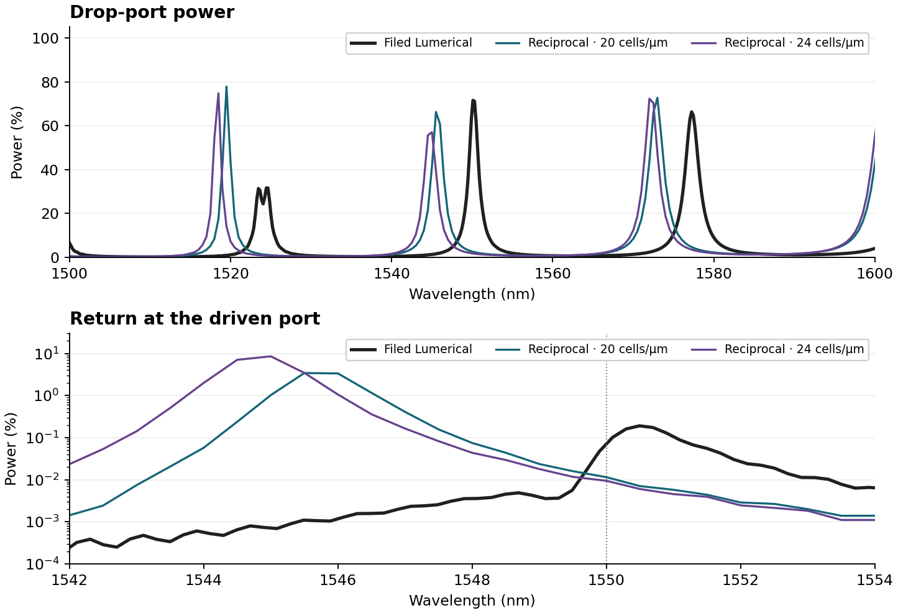

# Stability of the finite-height ring wall update

The 24-cell/µm Lumerical acquisition exposed a late instability in the original `wall-tensor` operator. The last quarter of all three Hz probe histories grew to hundreds of field units after the pulse ended. The highest collected guided power was 1.741. Of 241 wavelengths, 224 failed the recording-window check, 127 failed passivity, 147 failed incident magnitude and 118 failed incident phase. An isolated 1527 nm sample passed the local checks, but the unstable evolution invalidates its scattering result too. We preserve the native arrays and their original mask for diagnosis. The SHA-bound stability decision withholds the whole spectrum, all phases and every return peak. The device accumulated 134,360 steps over 6,250,272 cells in 1,432.121 s of synchronized step scopes, with 1,432.321 s on the CUDA event clock. [Native acquisition](verification/v014-ring3d-lumerical-r24-t3200-wall-tensor.json) · [Stability decision and measured probe growth](verification/v014-ring-wall-stability.json).

Applying the same severe-growth screen to every original `wall-tensor` record rejects only the Lumerical 24-cell case. The largest fourth-quarter/first-half probe peak ratios were 0.067 and 0.026 for the two 16-cell Lumerical windows, 0.022 at Lumerical 20 cells, and 0.022 / 0.034 for Tidy3D 16 / 20 cells. The rejected mesh reached a per-probe ratio of 4,832. The coarse runs still require their own wavelength and mesh-convergence gates. [All original-wall stability checks](verification/v014-original-wall-all-stability.json).

## Shared staggered coupling

The original xy and yx rows sampled the local inverse dielectric tensor at different Yee locations. As a result the Ex→Ey and Ey→Ex interactions between the same two edges could differ. Their largest mismatch in the tested 24-cell curved-wall tile was 0.05860 in inverse-permittivity units. This violates a known sufficient condition for stability of anisotropic Yee discretizations. The measurement supports this mechanism without proving that every observed feature in the earlier coarser runs has that cause. [Werner and Cary, 2007](https://www.sciencedirect.com/science/article/pii/S0021999107002227) · [Werner, Bauer and Cary, 2013](https://arxiv.org/abs/1212.4857).

The control uses the symmetry principle from those papers, with a pair averaging and bounding rule specific to this implementation. The distinct `reciprocal-wall` model retains the exact ring and bus areas, physical 100 nm gaps, component-centered diagonal inverse permittivities and vertical mixture. Each Ex edge has at most four adjacent Ey partners. For each pair we average its two locally sampled off-diagonal coefficients, bound this average and divide by four. Both update directions use this one stored link. Source planes remain diagonal and use the original straight-lead mode construction. The native FDTDX curl, PML memories, magnetic update and source operations are retained.

For a pair with diagonal inverse entries $d_i,d_j$, let $m=1/\epsilon_{\max}$ and $M=1/\epsilon_{\min}$ in the lossless dielectric model. Clamp the averaged off-diagonal entry to a magnitude at most

$$
\min\!\left(\sqrt{(d_i-m)(d_j-m)},\sqrt{(M-d_i)(M-d_j)}\right).
$$

Each stored link is one quarter of the bounded value. The full discrete operator $B$ is symmetric. For a real test vector $u$, the magnitude of $2B_{ij}u_i u_j$ is at most $((d_i-m)u_i^2+(d_j-m)u_j^2)/4$. Summing at most four pairs at each edge yields $u^T B u\ge m\lVert u\rVert^2$. Applying the same argument to $MI-B$ yields $u^T B u\le M\lVert u\rVert^2$, up to coefficient rounding. Here $M\le1$, so the uniform-grid vacuum Courant bound is sufficient for the source-free periodic lossless interior. The PML and driven device receive separate numerical checks. The link bound changes some interface weights, so spectral accuracy still needs independent mesh and vendor tests.

## Bounded checks before the device acquisition

The 16 × 16 × 6 periodic tile uses curved-interface coefficients cropped from the actual Lumerical 24-cell mesh near a 45° wall. Its assembled sparse matrix has zero transpose discrepancy and eigenvalues from 0.08257365 to 1.00000000. Random E/H fields excited the whole tile. In 8,192 CPU steps the relative drift of the discrete leapfrog energy, $E_n^T B^{-1}E_n+H_n^T H_{n-1}$, was 1.07 × 10⁻⁷ against the declared 2 × 10⁻⁴ limit. A separate analytic rotated standing wave had maximum field error 9.09 × 10⁻⁷. With a homogeneous rotated tensor, native source and six PML faces, the specialized and independent dense updates agreed to 1.27 × 10⁻⁷ or better in E, H and both PML memories. [CPU energy, eigenvalue, wave and PML receipts](verification/v014-reciprocal-wall-cpu.json) · [Validation program](../scripts/validate_reciprocal_ring_wall.py).

The native worker screens the full time trace before reporting a spectrum. After source shutoff, rejection requires increasing amplitudes at all three probes in the last two quarters, fourth-quarter peaks exceeding eight times each probe’s first-half maximum, and collected power above 1.05 in at least 10% of wavelengths. That combination clears all usable wavelength flags while preserving the local mask. Passing this severe-instability screen still leaves the per-wavelength launch, duration, passivity and commercial-accuracy checks in force.

## Memory admission for fresh high-resolution stages

At 20 or 24 cells/µm the reciprocal worker checks the budget inside each uncached reference/device calculation. It verifies the numerical source hashes, installed numerical payload, CUDA driver, GPU model, allocator settings, physical fixture and mesh. It reads free memory for the selected GPU immediately before allocating the new stage. The larger of measured board-memory increase and allocator peak in each 16-cell role is scaled by total cells, with 40% margin and another 2048 MiB reserve. The greater role estimate must fit. Verified existing stages reuse their earned acquisition receipts without consulting the reservation. The budget’s SHA and actual available memory are stored on newly acquired stages.

A local developer can profile the same model on a different GPU using the registered FDTDX interpreter and a source tree that matches the worker. Serialize profiling and solver work on that card. Use the resulting JSON through `PHOTONICS_RING_MEMORY_PLAN` when running a fresh high-resolution job.

```bash
"$FDTDX_PYTHON" -m scripts.profile_ring_wall_memory --source "$PWD" --vendor lumerical \
  --model reciprocal-wall --base-mesh 16 --candidate-mesh 24 --output my-ring-budget.json
PHOTONICS_RING_MEMORY_PLAN="$PWD/my-ring-budget.json" "$FDTDX_PYTHON" \
  -m scripts.run_reciprocal_ring3d --vendor lumerical --device gpu --resolution 24 \
  --duration-um-c 3200 --ring-interface reciprocal-wall --checkpoint my-stages --output fresh-ring
```

The same independently compiled periodic stress control ran on the RTX 3080 Ti Laptop GPU. Relative energy drift was 1.31 × 10⁻⁷ across 8,192 steps, with 0.334 s synchronized stepping and 0.342 s of CUDA event elapsed time. The 16-cell role probes measured a conservative 8,372 MiB requirement for the 24-cell full ring, versus 12,501 MiB free at its outer admission check. The worker repeats that check before each newly computed stage. [GPU energy receipt](verification/v014-reciprocal-wall-gpu.json) · [Measured memory profile](verification/v014-ring-memory-lumerical-r24-reciprocal.json) · [Outer admission](verification/v014-ring-admission-lumerical-r24-reciprocal.json).

The 24-cell pilot exercised the refusal path. After recording the straight stage, its process retained GPU allocations and the board reported 8,235 MiB free against the 8,372 MiB requirement. The native worker withheld the device stage. A fresh process reopened the verified straight checkpoint, released the prior allocator pool and rechecked the same budget before proceeding. The normal reciprocal entry creates a temporary checkpoint when none is supplied. It retries once, and only after observing this specific post-reference refusal and verifying a newly written reference archive. Other failures propagate. [Original admission and recovery evidence](verification/v014-reciprocal-ring-admission-recovery.json) · [Native orchestration](../scripts/run_reciprocal_ring3d.py).

## Full 24-cell result

The corrected 24-cell Lumerical ring passed the whole-trace screen and all 241 native wavelength checks. The peak absolute Hz ranges across the three probes were 0.160–0.191 in the first quarter, 0.0365–0.0383 in the second, 0.0112–0.0116 in the third and 0.00371–0.00409 in the fourth. The largest collected guided power was 1.00252. At identical physical geometry, nominal gap, raw sidewall coefficients, source sections and mesh, the original acquisition had late growth and power up to 1.741. The corrected operator limited 13,912 of 32,160 candidate edge pairs. Its links have a separate recorded SHA. The device used 6,250,272 cells, 134,360 steps, 1,659.562 s synchronized / 1,659.777 s CUDA elapsed, with the verified straight-stage acquisition reused after allocator recovery. [Native stable 24-cell spectrum, fields, stage times and admissions](verification/v014-ring3d-lumerical-r24-t3200-reciprocal-wall.json) · [Same-geometry controls and reference power errors](verification/v014-reciprocal-ring-comparison.json).

At 1550 nm through/drop powers are 97.691% / 1.8034%, against the unshifted filed 9.3915% / 67.4423%. Reflected/add-side powers are 0.009424% / 0.011646%, against 0.076158% / 0.082454%. The central local drop peak at 1545 nm is 5.092 nm below the filed 1550.092 nm peak, whose linewidth is 1.421 nm. The measured central FSR is 27.0 nm versus 25.4549 nm. Through/drop mean absolute power errors across all 201 vendor-band wavelengths are 0.12535 and 0.08843.

The low return at 1550 nm occurs away from the corrected ring’s own resonance. A denser direct transform of the same measured trace finds reflected and add-side peaks at 1544.85 nm, with powers 9.1707% and 9.1402% and FWHM about 1.09 nm. The filed reflection at the same wavelength is approximately 0.000748%, and its separate central peak near 1550.493 nm reaches 0.19065%. The measured return remains resonant after the stability correction. The phase registration at vendor planes gives through/drop RMS residuals 1.008 / 1.554 rad on 200 / 195 supported samples. Angular-mode attribution still needs complex fields sampled around the circumference. [Unshifted target-band check](verification/v014-reciprocal-ring24-return-band.json) · [Measured resonance-centered check](verification/v014-reciprocal-ring24-return-resonance.json) · [Vendor-plane phase and return diagnostics](verification/v014-ring-phase-reciprocal.json).

## Matched 20- and 24-cell spectra

Both reciprocal meshes passed all 241 native wavelength checks. Their three central sample peaks are 1519.5 / 1545.5 / 1573.0 nm at 20 cells/µm and 1518.5 / 1545.0 / 1572.0 nm at 24. The independently preregistered 20-cell prediction based on straight-guide propagation missed all three peaks by −4.020, −4.543 and −4.095 nm. Straight lead propagation alone does not account for the measured change in this bent, loaded ring. [Prospective forecast and measured result](verification/v014-reciprocal-ring-straight-forecast-check.json).

| At 1550 nm | Through | Drop | Reflection | Add side |
|---|---:|---:|---:|---:|
| Filed Lumerical | 9.392% | 67.442% | 0.07616% | 0.08245% |
| Reciprocal 20 cells/µm | 96.684% | 2.652% | 0.01147% | 0.01219% |
| Reciprocal 24 cells/µm | 97.691% | 1.803% | 0.00942% | 0.01165% |

The 20-cell device ran 111,966 steps on 3,601,360 cells in 875.010 s synchronized / 875.219 s CUDA elapsed. Across the 201 jointly qualified wavelengths, the largest absolute mesh differences reach 82.42 percentage points through, 63.81 drop and 7.53 reflection. The fixed-central-mode analysis at the filed planes gives through/drop mesh phase RMS differences of 0.5745 / 0.6519 rad. Local resonant reflected power peaked at 3.990% near 1545.75 nm on the 20-cell mesh and 9.171% near 1544.85 nm on the 24-cell mesh. These are substantial differences within a nominally weak channel despite the improvement in time stability. The 20-cell broadband through/drop MAEs are 0.12046 and 0.08502 against the filed data. [Complete same-operator mesh comparison](verification/v014-reciprocal-wall-meshes.json) · [20-cell measured return line](verification/v014-reciprocal-ring20-return-resonance.json) · [Filed-plane phase diagnostics](verification/v014-ring-phase-reciprocal.json) · [Native 20-cell result](verification/v014-ring3d-lumerical-r20-t3200-reciprocal-wall.json).



The qualified 24-cell result was also exported through the normal application and replayed by its Python program and unchanged Jupyter notebook using the verified stages. Every numerical array matched the original measured bytes. Its package contains the numerical worker, orchestrator, exact memory profile, FDTDX notice and timing CSV. [Release asset hash and both executed replay receipts](verification/v014-reciprocal-ring-result-export.json).
