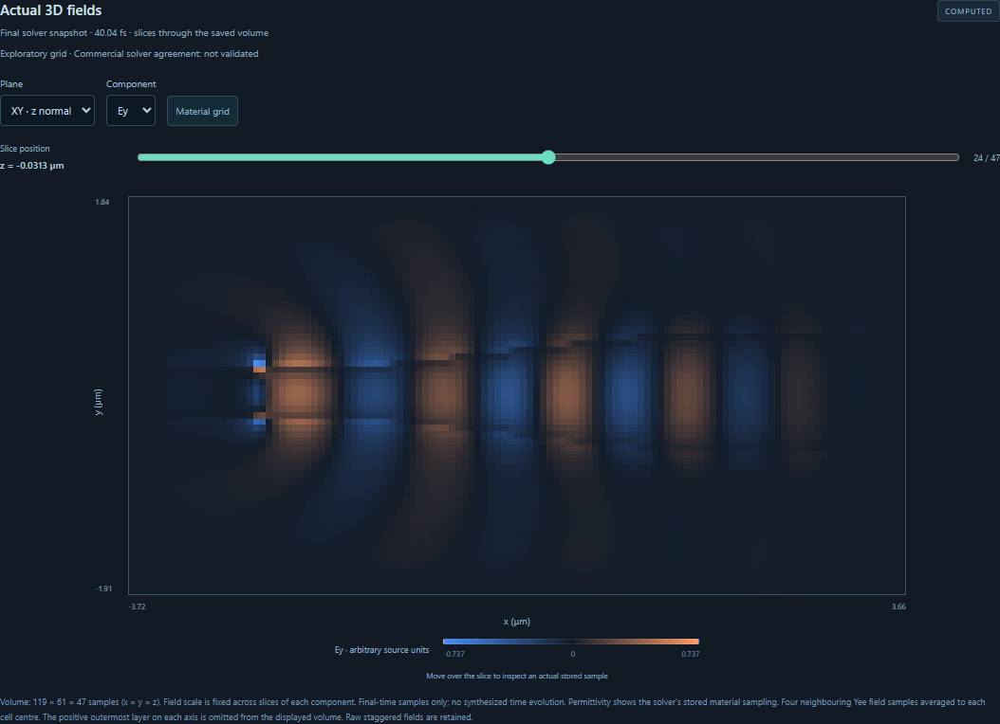

# Finite-height taper fields

Open **3D design → Photonic component library → Linear taper → Open as new design**.
Set the input and output widths, length and core height. Validate the study and
inspect its solver domain and source plane. Select an available execution target,
run, then switch between the material grid and Ex, Ey or Ez in XY, XZ and YZ.
The results panel exports its recorded configuration, numerical data and a
standalone Python/Jupyter bundle.

The default taper widens from 0.4 to 1.2 µm over 6 µm and has a height of
0.22 µm. A browser verification case widens from 0.5 to 1.15 µm over 3 µm
and has a height of 0.3 µm. This is the computed Ey field for that case.

## Physical model

Schema 5 contains the complete editor document and explicit solver/device. The
two end faces must belong to a single centered, unrotated, intact taper. Its
four polygon vertices, height, material link and named end faces are checked
against the recipe. The core uses a constant real index above the homogeneous
cladding. Straight input/output leads extend the end-face widths to the x
boundaries. The solver cell expands as necessary for the leads, cladding and
six absorbing faces. The design snapshot retains its original dimensions.

The finite Ey source lies inside the input access guide and ramps to a continuous
wave. Meep uses a bidirectional electric current sheet. FDTDX uses a directed
plane injection. Each solver saves its final instantaneous signed field and
actual sampled permittivity. Source amplitudes and spatial sampling differ.
The physical outputs here are field volumes. Modal transmission, insertion loss,
S-parameters and commercial reference agreement remain outside this taper study.

Both widths and the core height require four grid cells, each PML requires
eight, and the highest-index material requires ten cells per wavelength.
Requests above 1.2 million grid cells or 1.2 billion planned cell updates are
rejected before execution. These are minimum sampling and resource checks.
Quantitative accuracy requires refinement of the chosen geometry and observable.

## Verification

- **Meep CPU.** The straight-limit taper matches a native uniform block exactly
  in permittivity and all three electric fields. A single extrusion includes
  both access guides, eliminating an artificial numerical seam found in
  separate touching objects. The widened taper changes the field. Checks at
  16 and 20 cells/µm compare material width/height to the requested geometry.
  [Native cases and array hashes](verification/meep-taper.json)
- **FDTDX CPU and NVIDIA.** On the default study, all 982,800 voxel values
  matched the expected taper and leads. CPU/GPU field relative L2 difference
  was 1.77 × 10⁻⁶ on identical coordinate and material grids. Changing to a
  straight guide changed 6,752 material voxels. A masked GPU failed explicitly.
  [Native cases and device record](verification/fdtdx-taper.json)
- **Browser.** An edited taper completed on all three explicit targets.
  Pixel samples in all nine plane/component combinations were checked against
  saved solver samples. Editing the design after the solve preserved the run
  configuration. [Meep](verification/v08-taper-browser-meep-cpu.json) ·
  [FDTDX CPU](verification/v08-taper-browser-fdtdx-cpu.json) ·
  [FDTDX NVIDIA](verification/v08-taper-browser-fdtdx-gpu.json)
- **Repeatability.** The separate browser CPU/GPU runs used the same FDTDX
  physical inputs and final sample time. Their measured full-field relative
  L2 difference was 1.10 × 10⁻⁶. [Comparison](verification/taper-cpu-gpu-comparison.json)

- **Python and Jupyter.** All six solver replays from the three GUI downloads
  reproduced every saved numerical array byte-for-byte. Each executed notebook
  rendered a field plot. [Standalone execution records](verification/taper-exports.json)

The source archives include the geometry validator, taper compiler, adapter and
worker. Exported numerical bundles can be replayed on the selected local target
without a running API. Geometry-only exports reproduce design edits separately.
[Reproduction instructions](REPRODUCIBLE_EXPORTS.md)
