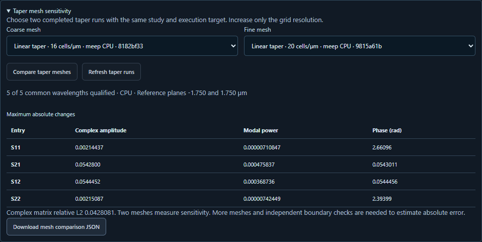

# Measure taper-port mesh sensitivity

Use two completed finite-height taper-port runs to see how sensitive each
measured scattering coefficient is to grid resolution. The comparison reads
local results and works offline without starting a solver.

In **3D design → 3D ports & S-matrix**, open **Taper mesh sensitivity**.
Choose the coarse run, then a finer run on the same solver and device. Click
**Compare taper meshes** to inspect power, amplitude and phase changes for
all four entries. **Download mesh comparison JSON** includes the per-wavelength
changes, validity flags, solver versions, physical planes and file hashes.
The browser and CLI use the same calculation.



## Compare exported results from the command line

1. In **3D design**, open the finite taper-port example. Select a solver and
   device and run it at 16 cells/µm. Export and extract the **results** ZIP.
2. Change only the resolution to 20 cells/µm and repeat. Keep the original
   taper, material, frequency band, simulation settings and target. Use grids
   that place the port planes, sources, PML and computational boundaries at the
   same physical positions. You can also use completed result directories
   produced by `isophotonix run`.
3. Supply the coarse and fine result directories in that order. Choose a new
   output filename. Omit `--output` to print the JSON report.

```bash
isophotonix compare-taper-mesh taper-r16 taper-r20 --output taper-mesh.json
```

The input directories must contain their original `config.json`,
`metadata.json`, `sparameters.npz` and `implementation.zip`. Both configurations
must match except for resolution. The command verifies the numerical source
archives, solver versions, recorded hardware, mode conventions, normalization
and physical coordinates. A change of numerical implementation between runs
requires collecting a fresh pair with a single implementation. Each accepted
report includes the compared file hashes.

## Reading a report

- **Power** is the signed change in normalized modal power, fine minus coarse,
  at each wavelength. **Phase** is the signed principal angular difference in
  radians at the saved port planes. Search `S21` for forward transmission and
  `S11` for forward reflection.
- **Qualified wavelengths** must have valid guided measurements on both
  meshes, sufficient reference excitation and settled directional runs.
  Excluded bins are flagged and their differences are null. Phase also
  requires both amplitudes to exceed the workbench's 10⁻⁸ amplitude floor.
  The report refuses pairs that have zero qualified bins in common.
- **Complex matrix relative L2** divides the norm of the complex differences
  across all four entries and jointly valid bins by the coarse matrix norm.
  The report also gives the maximum complex effective-index change at each
  end. Bright through channels can dominate a combined matrix norm. Inspect
  the individual reflection and phase entries for a weak return.
- Two meshes measure a change in the computed result. Estimating convergence
  order, absolute accuracy or a design tolerance requires more resolutions
  and independent checks on PML, domain size, material assumptions and
  source/monitor settings. The late-time field volumes have different grids
  and capture times and are outside this particular comparison.
  [Ansys guide to FDTD convergence testing](https://optics.ansys.com/hc/en-us/articles/360034915833-Convergence-testing-process-for-FDTD-simulations).

## Recorded example

The 2 µm taper expands from 0.75 to 1.00 µm, is 0.50 µm high, and has
refractive index 2 in index-1 cladding. The two physical port planes are at
−1.75 and +1.75 µm. For each solver the coarse result came from the GUI,
and the finer mesh ran four native Maxwell stages with the exact numerical
sources captured by that coarse run. The installed command compared all five
wavelengths, from 1.45 to 1.65 µm. Its scalar results are dimensionless
except for the phase columns.

| 16 → 20 cells/µm | Complex matrix relative L2 | Maximum S21 power change | Maximum S21 phase change | Maximum S11 phase change |
| --- | ---: | ---: | ---: | ---: |
| Meep CPU | 0.04281 | 0.000476 | 0.05430 rad | 2.661 rad |
| FDTDX on RTX 3080 Ti Laptop GPU | 0.05029 | 0.001071 | 0.06413 rad | 3.098 rad |

Forward transmitted power changes relatively little over these samples,
while weak reflected phase is highly mesh sensitive. These records qualify
this two-port analysis on Meep CPU and FDTDX NVIDIA. External reference
comparisons have their own matched geometries and observables.
[Meep report](verification/v010-taper-mesh-meep-cpu.json) ·
[FDTDX NVIDIA report](verification/v010-taper-mesh-fdtdx-gpu.json) ·
[Commercial example comparisons](COMPONENT_REFERENCE_CHECKS.md).

A separate fresh four-stage Meep run at 20 cells/µm was registered through
the workbench job manager and compared with the original coarse GUI run.
The browser displayed all four entries, rejected a coarse run from a
different numerical implementation, and downloaded JSON equal to its API
response. All power and phase entries matched the installed CLI report.
[Browser checks](verification/v010-taper-mesh-browser.json) ·
[Actual browser download](verification/v010-taper-mesh-browser-download.json).
