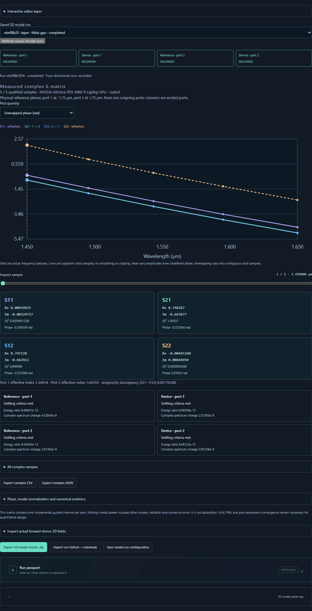

# Complex S-parameters for a finite-height taper

Choose **3D ports & S-matrix → Open taper port example**. Inspect the exact
editor taper, optical band, mesh, absorbing boundaries and the two physical
measurement planes. Select Meep CPU, FDTDX CPU or FDTDX NVIDIA explicitly.
The result displays S11, S21, S12 and S22, their real/imaginary parts, phase
and power, plus the guided effective index at each end. The result ZIP includes
the native monitors and the sampled forward-device field. The Python/notebook
export reruns the four directional stages locally.

## Measurement

The default transition is 2 µm long and 0.5 µm high. Its width changes from
0.75 to 1.0 µm in a homogeneous index-1 cladding around an index-2 core.
The default computational domain is 8 × 4 × 4 µm. The transition ends at
x = ±1 µm, the port planes are at ±1.75 µm and the sources at ±2.75 µm.
Both leads run through the X PML.

1. The forward uniform reference has the input-end width throughout.
2. The forward device uses the actual taper contour and both matched leads.
3. The reverse uniform reference has the output-end width throughout.
4. The reverse device excites the actual taper from its wider end.

Each excitation column divides by its measured incident fundamental mode.
Each end has its own mode profile and effective index. Reflected amplitudes
use coherent incident-reference subtraction. The recorded phase is referenced
to the two physical port planes. There is no through correction or fitted
phase rotation. Reciprocity, unaccounted fundamental-mode power and time
settling remain visible, including small excess powers above one.

Meep uses native MPB mode decomposition and the continuous taper prism.
FDTDX uses an explicitly sampled voxel grid, local transverse mode solutions,
and E/H projection at the selected frequencies. The two methods discretize
the taper boundaries and Yee fields differently. Source modes for FDTDX use
local CPU preparation while electromagnetic time evolution uses the selected
CPU or NVIDIA device.

## Numerical limits

For the default five-bin case, both solvers resolved distinct left and right
guided modes. At the sample near 1.54355 µm the Meep and FDTDX forward through
powers were about 0.99911 and 0.99953. Their forward reflected powers were
about 2.76 × 10⁻⁶ and 1.94 × 10⁻⁴, respectively. The weak reflection differs
substantially in relative terms. Keep that difference when interpreting small
return losses. Neither numerical receipt establishes a precision rating for
weak reflection or a match to an external taper scattering dataset.

The uniform-width limit is a separate control. Mesh, physical reference
planes, finite aperture, turn-off time and mode normalization all matter.
Only settled bins with sufficient incident amplitude and a guided fundamental
mode at both ends are qualified. The two-port matrix leaves out radiation
and higher-order channels. [Published comparison scope](COMPONENT_REFERENCE_CHECKS.md)

For matched FDTDX CPU/GPU browser runs, the complete complex S matrices
differed by 4.23 × 10⁻⁸ in relative L2 norm. Across the five Meep/FDTDX
bins, maximum forward through-power difference was 0.00105, while the
maximum forward phase difference was 0.102 radians. Refining from 16 to 20
cells/µm changed forward phase by up to 0.054 radians in Meep and 0.064 radians
in FDTDX.
These differences help assess each observable separately.
[Browser comparison](verification/v09-taper-ports-comparison.json) ·
[FDTDX native checks and refinement](verification/fdtdx-taper-ports.json).

All six taper-port replays from the browser downloads (Python and notebook on
each target) passed the original pointwise checks. The complex S arrays
matched the GUI byte for byte. Four GPU notebook energy diagnostics varied by
up to 1.53 × 10⁻⁵ in absolute value. An earlier Meep replay reproduced S but
missed the raw-monitor tolerances. The final adapter builds the reference and
device leads with the same prism geometry and explicitly initializes the
seeded simulation before registering monitors. Its final replays reproduced
every saved array byte for byte.
[Six export checks](verification/v09-taper-port-exports.json) ·
[Meep controls and refinement](verification/v09-meep-taper-ports.json) ·
[Earlier replay and correction](verification/v09-meep-taper-replay-investigation.json).
