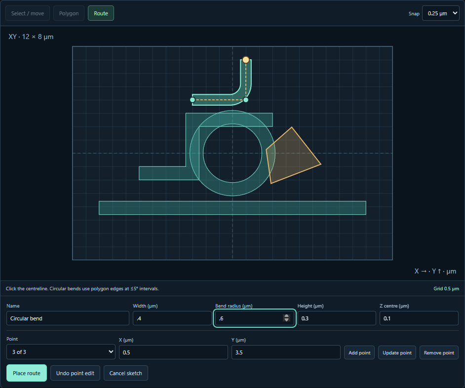

# Draw and edit a photonic layout in XY

Open the **3D design** workspace and choose **Draw in XY** above the viewport.
The board shows visible solid footprints in world coordinates. X points right
and Y points up. The displayed domain, point coordinates, route width, bend
radius and extrusion dimensions are in micrometres. Switch to **3D view** to
inspect the design in perspective.

- **Polygon** adds an extruded, closed contour. Click its vertices in order,
  or enter exact X/Y values with **Add point**. Choose its height and Z centre,
  then use **Place polygon**.
- **Route** takes centreline points and produces an extruded polygon with
  flat end faces. Set the full width and centreline bend radius. Radius zero
  uses miter joins. A positive radius places circular fillets tangent to the
  adjacent segments, with inner radius equal to the centreline radius minus
  half the width. Circular boundaries are sampled at intervals of at most 5°.
  Each straight segment must have room for its neighboring fillets. The saved
  contour contains the physical polygon vertices used for display and export.
- **Select / move** drags a solid across the board. Dragging a library
  component moves all of its solids, named ports and recipe placement together.
  **Edit contour** opens a selected polygon’s outer boundary or hole in world
  XY. Manual contour edits to a generated component detach its recipe when
  applied.

Pointer placement and dragging follow the chosen snap spacing. Typed coordinates
remain exact, including values between grid lines. The displayed grid can use
a multiple of the snap spacing to keep lines legible. Drag a draft vertex or
select its number and use **Update point**. **Undo point edit** and **Redo point edit** act on the
uncommitted sketch. **Cancel sketch** abandons it. Once placed, each edit or
move takes one step in the editor’s ordinary **Undo / Redo** history.

A sketch must be simple, fit the design domain including its extrusion, and
stay within the existing polygon format’s 256 vertices per contour. Self
crossings, collapsed segments, impossible corner radii and out-of-domain
placements leave the current scene intact. Committed routes are editable
polygon contours. Their centreline and radius are construction inputs.

Export geometry JSON, or choose the geometry Python/notebook export to reproduce
the drawn design locally. A field study separately checks material, source,
sampling and compute limits for the complete scene. [Browser checks](verification/v09-sketch-browser.json)
and [executed standalone export](verification/v09-sketch-export.json).

[Whole-component deletion, editor undo and named-port alignment](EDITOR_RECOVERY.md).
